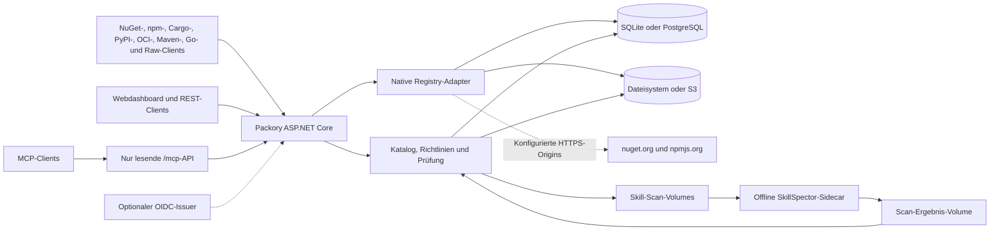

<picture>
  <source media="(prefers-color-scheme: dark)" srcset="docs/branding/banner-dark.svg">
  
</picture>

# Packory

**Marke und UI:** [Logo und Hell-/Dunkel-Designvorlagen](docs/branding/README.md) (ausschließlich Entwürfe).

**Sprache:** [English](README.md) · **Deutsch**

[](https://github.com/Cenn0/Packory/actions/workflows/ci.yml)
[](LICENSE)

**Direkt zu:** [Schnellstart](#schnellstart) · [Funktionen](#umgesetzte-funktionen) · [Architektur](#architektur-im-überblick) · [Dokumentation](docs/README.md) · [Roadmap V3](docs/roadmap.md) · [Roadmap V4](docs/roadmap-v4.md) · [MCP-Roadmap](docs/mcp-roadmap.md) · [Kompatibilitätsmatrix](docs/support-matrix.md)

**Eine selbst gehostete Distributionszentrale für Entwicklerpakete und KI-Agent-Skills.**


Packory bündelt native Registry-Schnittstellen, einen indexierten Artefaktkatalog und ein einfaches Webdashboard. Die aktuelle Implementierung ist ein modularer Monolith mit **ASP.NET Core / .NET 10**. SQLite und lokaler Dateispeicher sind der Standard; PostgreSQL als Metadatenspeicher und S3-kompatibler Objektspeicher sind optional. Ein Message-Broker oder Kubernetes sind nicht erforderlich. Erste Härtungen umfassen Artefakt-Sperren innerhalb eines Prozesses, reservierte private Namensräume, einen Abgleich des Dateispeichers beim Start, **transaktionale Audit-Einträge erfolgreicher Veröffentlichungen** und nach Tokenrolle getrennte Ratenbegrenzung für Schreibvorgänge.

> **Status: aktive Entwicklung mit dokumentiertem Funktionsumfang.** Die Adapter und optionalen Speicher-Backends sind nur begrenzt getestet; vollständige Protokollkompatibilität, Recovery nach Migrationen und Mehrinstanzgarantien sind nicht nachgewiesen. Der Katalog zeigt lokal gehostete oder bereits gecachte Pakete, nicht den vollständigen Inhalt der Upstream-Registries. Die [Support-Matrix](docs/support-matrix.md) nennt den jeweils implementierten und getesteten Umfang.

**Private Hosted-Feeds nach E0 sind für NuGet, npm, Cargo, PyPI, OCI, Maven, Go und Raw implementiert.** Jeder aktive Feed besitzt eigene native Routen, exakte Lese-/Publikationsrechte und unveränderliche Artefaktidentitäten. Private Anfragen greifen niemals auf globale Pakete oder Upstreams zurück. Alle acht lokalen nativen Profile, ausgewählte native PostgreSQL-/Moto-Profile, die private Offline-Wiederherstellung und die vollständigen lokalen Tests sind erfolgreich geprüft. Alle acht GitHub-Workflows sind auf dem Implementierungscommit erfolgreich; die vollständigen Nachweise stehen in [E0-Abnahme](docs/e0-acceptance.md). Proxy-/Group-Feeds, private Skills und Feed-bezogene MCP-Suche bleiben eigene Aufgaben.

> Vorgebaute Entwicklungs-Container aus GitHub Container Registry: [Images und Bereitstellung](docs/container-images.md).

## Schnellstart

Voraussetzung: Docker Compose. Für die lokale Erprobung:

```bash
git clone https://github.com/Cenn0/Packory.git
cd Packory
export PACKORY_ADMIN_TOKEN="$(openssl rand -hex 32)"
docker compose up -d --build
```

Öffne **http://localhost:8080/**. Der Token schaltet administrative Aktionen frei; lege ihn nicht in Git ab und veröffentliche ihn nicht in Issues. Die Compose-Konfiguration bindet an `127.0.0.1:8080` und speichert Daten dauerhaft im Volume `packory-data`.

Alternativ direkt mit dem .NET-10-SDK starten:

```bash
export PACKORY_ADMIN_TOKEN="$(openssl rand -hex 32)"
export PACKORY_PUBLIC_BASE_URL=http://localhost:8080
dotnet run --project src/Packory --urls http://localhost:8080
```

Vor einem Netzwerkzugriff oder der Einrichtung eines dauerhaften Datenverzeichnisses die [Betriebsanleitung](docs/operations.md) lesen.

## Umgesetzte Funktionen

| Bereich | Umgesetzter Umfang |
| --- | --- |
| **NuGet V3** | Service-Index, Paket-/Versionsdownloads, Read-through-Caching von nuget.org und Veröffentlichung eigener Pakete; experimentelle getrennte private NuGet-Feeds mit eigenen Berechtigungen |
| **npm** | Globale Metadaten-/Tarball-Caches sowie private Veröffentlichung mit und ohne Scope, Packuments, Tags bei Veröffentlichung und geprüfte Tarballs; native Install-/CI-Abläufe |
| **OCI (experimentell)** | Globale und private Distribution-v2-Blobs, fortsetzbare Uploads, Manifeste, veränderliche Tags und Referrer; private Repositories unter `/v2/feeds/{id}/` |
| **Cargo & PyPI (experimentell)** | Globale und private Cargo-Sparse-Registries mit nativem Publish; PyPI Simple HTML/JSON und Twine-Upload unveränderlicher Distributionsdateien |
| **Helm 3 über OCI (experimentell)** | Native Helm-OCI-Push/Pull/Show/Template-Smoke-Tests mit festgelegter CLI-Version; kein allgemeiner Helm- oder Kubernetes-Konformitätsnachweis |
| **Maven und Gradle (experimentell)** | Globale und private native Maven-Deploys, unveränderliche Releases und zeitgestempelte SNAPSHOT-Dateien, exakte Metadaten und Prüfsummen; transitive Maven-/Gradle-Auflösung; kein Upstream-Proxy |
| **Go-Module (experimentelles Hosting)** | Globaler und privater authentifizierter Import/native GOPROXY-Downloads; unveränderliche Modultripel und kanonische `h1:`-Inhaltshashes; kein Upstream-Mirror oder externes Prüfsummendatenbank-Vertrauen |
| **Raw / Generic (experimentell)** | Globale und private unveränderliche HTTP-Uploads/-Downloads mit SHA-256-Metadaten und Range-Lesezugriff; generische Dateien ohne natives Paketmanager-Protokoll |
| **Agent Skills** | Versionierter ZIP-Import mit Quarantäne, offline statischer SkillSpector-Prüfung, expliziter Freigabe vor REST-/MCP-Auslieferung bei aktivierter Durchsetzung sowie Widerruf/erneuter Prüfung |
| **Statische Skill-Qualität** | Deterministische Dokumentationsbefunde, Verbesserungsvorschläge und Prüfungsabdeckung für veröffentlichte unveränderliche Skills über MCP, REST und Dashboard; getrennt von Sicherheits- und Verhaltenstests |
| **Packory MCP** | Authentifizierter, nur lesender Streamable-HTTP-Endpunkt `/mcp` mit Tools, Ressourcen, Prompts und Skills Extension; seitenweise globale Artefakt-/Versionssuche einschließlich Maven und Raw |
| **MCP-Serververzeichnis** | Versionierte Remote-`server.json`-Metadaten mit administrativer Prüfung/Freigabe/Widerruf; drei lesende `/v0.1`-Routen, MCP-Tools und Dashboard mit Folgeseiten; keine externe Ausführung oder verifizierte Herausgeberidentität |
| **Dashboard/API** | Durchsuchbarer Katalog gecachter/gehosteter Artefakte, MCP-Serververzeichnis, Skill-Qualitätsberichte sowie Liveness-/Readiness-Endpunkte |
| **Zugriff** | Statische Read-/Write-/Admin-Tokens sowie optionale OIDC-JWT-Prüfung mit expliziten `packory.read`-, `packory.write`- und `packory.admin`-Scopes; noch kein Browser-SSO/BFF |
| **Speicher** | SQLite und Dateisystem standardmäßig; optional PostgreSQL-Metadaten und S3-kompatible Blobs für neue Einzelinstanz-Installationen |

**Privates Hosted-Profil:** Einen deaktivierten Entwurf anlegen, als Administrator ausdrücklich aktivieren und einen exakten verwalteten Grant `feed:{id}:read` oder `feed:{id}:publish` ausgeben. Die meisten Quellen liegen unter `/feeds/{id}/{protokoll}/`; OCI behält seinen nativen Präfix unter `/v2/feeds/{id}/{repository}/`. Die bisherigen globalen URLs bleiben erhalten; der OCI-Repository-Präfix `feeds/` ist für private Routen reserviert. [Feed-Lebenszyklus, Clientkonfiguration und Grenzen](docs/feeds.md) beschreiben die Details.

Privates npm unterstützt Tags bei der Veröffentlichung, aber keine separate veränderliche Tag-/Unpublish-API. Privates Cargo bietet eine experimentelle, auditierte und Feed-begrenzte Yank-/Unyank-API (Schema V14); Eigentümerverwaltung und Upstream-Proxy sind weiterhin offen. Privates PyPI akzeptiert ein begrenztes kanonisches PEP-440-Profil ohne Epoch; der native Nachweis gilt für Wheels, direkte Dependency-URLs werden abgelehnt. Maven unterstützt native Release- und SNAPSHOT-Deploys sowie gewöhnliche Maven-/Gradle-Abhängigkeiten; atomare Veröffentlichung eines vollständigen Dateisatzes und Proxying bleiben offen. Go benötigt für native GOAUTH-Zugangsdaten HTTPS und bietet weder Upstream-Mirror noch Prüfsummendatenbank-Verifikation. Die [Support-Matrix](docs/support-matrix.md) nennt die exakt geprüften Clients und offenen Funktionen.

### Packory als Paketquelle nutzen

NuGet-Service-Index: `http://localhost:8080/nuget/v3/index.json`.

```bash
# HTTP ausschließlich zur lokalen Entwicklung verwenden.
dotnet nuget add source http://localhost:8080/nuget/v3/index.json \
  --name packory --allow-insecure-connections

# npm-Registry nur für diesen Befehl verwenden.
npm install --registry=http://localhost:8080/npm/ lodash
```

Zum Veröffentlichen von Paketen wird ein passender Token benötigt. Die [API-Beispiele](docs/api.md) zeigen NuGet Push, npm-Veröffentlichung und ZIP-Import für Agent Skills, ohne Zugangsdaten in versionierten Dateien abzulegen. Bei aktivierter Skill-Sicherheitsrichtlinie werden ZIPs **zunächst isoliert und erst nach autorisierter Freigabe ausgeliefert**. Die statische Offline-Prüfung durch SkillSpector unterstützt die Begutachtung, **ist aber kein Nachweis für sicher ausführbare Skills**. Siehe [MCP-/SkillSpector-Integration](docs/mcp-security-integration.md) und [Checkpoint vom 20. Oktober](docs/roadmap-status-2026-10-20.md).

### MCP-Suche und Skill-Qualität

Ein autorisierter MCP-Client kann über `/mcp` globale Artefakte suchen, Paketversionen durchblättern und veröffentlichte Skills lesen. Native Tests mit dem C#-SDK decken die Protokollrevisionen **2025-06-18, 2025-11-25 und 2026-07-28** ab. Cursor für Folgeseiten ermöglichen die vollständige Abfrage von Katalog, Skills und Verzeichnisinhalten; die bisherige Kataloggrenze von 100 Einträgen entfällt. Maven und Raw sind einbezogen, private Feed-Einträge bleiben außerhalb des globalen MCP-Katalogs. Das [MCP-Serververzeichnis](docs/mcp-registry-catalog.md) stellt separat geprüfte Remote-Metadaten über die drei lesenden `/v0.1`-Routen, die Packory-Verwaltungs-API und das Dashboard bereit.

Die statische Dokumentationsanalyse ist über **`assess_skill_quality(name, version)`**, `GET /api/v1/skills/{name}/{version}/quality` oder **Assess quality** im Dashboard verfügbar. Der Bericht enthält getrennte Befunde, konkrete Verbesserungsvorschläge, Hashes der exakten Quelldaten und Hinweise auf unvollständige Abdeckung. Geprüft werden Frontmatter, Anweisungstext und erkannte lokale Markdown-Verweise. Importierter Code wird nicht ausgeführt; externe Dienste werden nicht kontaktiert. Ein abgeschlossener Bericht kann Fehler enthalten und bestätigt weder Sicherheit noch Herausgeberidentität oder funktionale Korrektheit. [Statische Skill-Qualität](docs/skill-quality.md) beschreibt das Prüfprofil, seine Grenzen und Zugriffsregeln.

Die [MCP-Roadmap](docs/mcp-roadmap.md) trennt diese gelieferten Funktionen von offenen Eigentumsnachweisen für Herausgeber, Signaturprüfung, Upstream-Synchronisierung, weiteren Manifesttypen, zusätzlicher SDK-Konformität und Feed-bezogener Suche. Verhaltenstests für Agents und Connectoren sowie ein externes MCP-Gateway benötigen eigene isolierte Ausführungsumgebungen und Abnahmetests.

## Architektur im Überblick



Jeder Adapter behält sein natives Protokoll und verwendet gemeinsame Autorisierung, Persistenz und Recovery. Schema V11 erhält das private Artefakt-Ledger und OCI-Tag-Referenzen und ergänzt atomar gespeicherte Maven-Metadaten; npm/Cargo/PyPI speichern Protokollmetadaten und originale Paketbytes zusammen in einem geprüften unveränderlichen Bundle. Prozesslokale Sperren und Audit-Einträge sind keine Mehrinstanz- oder verteilte ACID-Garantie. Siehe [Architektur](docs/architecture.md), [Feed-Betrieb](docs/feeds.md) und [S3](docs/s3.md).

## Einschränkungen und Sicherheit

- NuGet und npm unterstützen wesentliche Registry-Abläufe, aber **nicht alle Protokollfunktionen**. Die konkret verwendeten Clients und Versionen müssen getestet werden.
- Die Suche umfasst nur lokal indexierte Artefakte. Aktuelle Upstream-Metadaten und noch nicht gecachte Downloads können Netzwerkzugriff benötigen.
- Statische Tokens sind keine individuellen Benutzerkonten. **OIDC-JWT-Prüfung ist implementiert; Browser-SSO/BFF, paketbezogene Rechte, persönliche Akteurszuordnung, vollständige/unveränderbare Audit-Protokolle und Hochverfügbarkeit fehlen noch.** Das Admin-Audit erfasst erfolgreiche Veröffentlichungen und ausgewählte Verwaltungsaktionen einschließlich Feed-Lebenszyklus, aber nicht jede Anfrage oder verweigerte Zugriffe.
- Konfigurierbare private NuGet-ID-Präfixe und npm-Scopes können einen Rückgriff auf öffentliche Registries für reservierte Namensräume verhindern. Das ist **keine vollständige Paket- oder Malware-Sicherheitsrichtlinie**. Signaturdurchsetzung, Cache-Eviction und automatische Lizenzkonformitätsprüfung fehlen weiterhin.
- Private Hosted-Feeds besitzen getrennte Grants und Speicheridentitäten. Proxy-/Group-Routing, private Skills, Feed-bezogene MCP-Suche, Kapazitätsabrechnung pro Feed und browsergestützte Rechteverwaltung sind weiterhin offen.
- **Native Adapter besitzen einen begrenzten Funktionsumfang.** PostgreSQL und S3 sind auswählbare Backends; automatische Migration von SQLite/Dateisystem zu PostgreSQL/S3 und verteilte DB-/Blob-Transaktionen fehlen. Ein eingeschränkter lesender Mehrinstanzmodus existiert, **mehrere gleichzeitig schreibende Instanzen sind nicht unterstützt**.

Nach Tokenrolle begrenzte Schreibzugriffe ergänzen die Schutzmaßnahmen, **ersetzen aber keine Ratenbegrenzung am Reverse-Proxy**. Sperren innerhalb eines Prozesses garantieren **keine Konsistenz über mehrere Instanzen**. Der Speicherabgleich beim Start kann ausgewählte inkonsistente Artefakte erkennen oder isolieren, ersetzt aber keine geprüften Backups. Der Standard-Docker-Port ist nur über Loopback erreichbar. Für gemeinsame Installationen sind HTTPS und explizite Zugriffskontrollen erforderlich. Tokens sicher verwahren, Logging und Upstream-Netzwerkzugriff prüfen sowie **Metadatenbank und Artefaktspeicher konsistent** sichern. Nicht vertrauenswürdige Skills oder Pakete dürfen nicht auf dem Server ausgeführt werden. Siehe [Sicherheit und Betrieb](docs/operations.md).

## Build und Tests

```bash
dotnet restore Packory.slnx
dotnet build Packory.slnx -c Release --no-restore
dotnet test Packory.slnx -c Release --no-build
node --check src/Packory/wwwroot/app.js
# Benötigt .NET 10 SDK, Node.js/npm, curl und OpenSSL:
bash scripts/smoke-hosted.sh
bash scripts/smoke-ecosystems.sh
```

Die [CI](.github/workflows/ci.yml) führt Build-, Integrations- und [echte CLI-Veröffentlichungstests](scripts/smoke-hosted.sh) aus: `dotnet nuget push` mit anschließendem isoliertem `dotnet restore/build` sowie `npm publish` für ein Scoped Package mit anschließendem `npm install` und `npm ci` in einem frischen Cache. Zugangsdaten entstehen nur temporär im Test. Die CI testet zusätzlich Cargo Publish/Consumption, einen echten pip-Installationslauf mit gehosteter transitiver Abhängigkeit und einen Docker-OCI-Push/Pull-Test mit lokal erstelltem Scratch-Image. Ein [separater Live-Smoke-Workflow](.github/workflows/smoke-live.yml) prüft öffentliche Upstream-Registries. Ein bestandener CLI-Test bedeutet noch keine vollständige Protokollkompatibilität.

Die privaten Feed-Tests ergänzen zwei Feeds mit gleichen Koordinaten und verschiedenen Bytes, exakte Berechtigungsfehler, isolierte Clientcaches und die jeweils dokumentierten Neustartprüfungen. [E0-Abnahme](docs/e0-acceptance.md) ordnet jedem Adapter Tests und Befehle zu, dokumentiert lokale native, Provider- und Wiederherstellungsergebnisse getrennt von der abschließenden CI-Abnahme und nennt die tatsächlich verwendeten Clientversionen.

## Dokumentation und Mitwirkung

[Dokumentationsindex](docs/README.md) · [MCP-Roadmap](docs/mcp-roadmap.md) · [Skill-Qualität](docs/skill-quality.md) · [Go-Modulregistry](docs/go-proxy.md) · [Maven](docs/maven.md) · [Raw / Generic](docs/raw-registry.md) · [Support-Matrix](docs/support-matrix.md) · [Roadmap V4](docs/roadmap-v4.md) · [Architektur](docs/architecture.md) · [API](docs/api.md) · [Betrieb](docs/operations.md) · [Roadmap](docs/roadmap.md) · [Mitwirken](CONTRIBUTING.md) · [Sicherheitsrichtlinie](SECURITY.md)

Lizenziert unter [Apache-2.0](LICENSE). Beiträge und öffentliche Fehlermeldungen sind willkommen. Sicherheitslücken über den vertraulichen Meldeweg der Sicherheitsrichtlinie melden.
