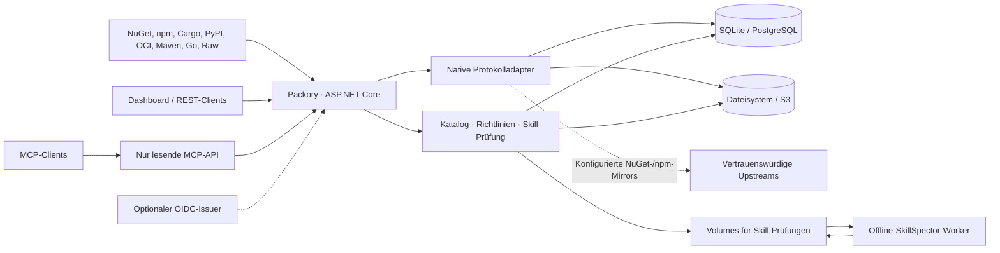

<picture>
  <source media="(prefers-color-scheme: dark)" srcset="docs/branding/banner-dark.svg">
  
</picture>

# Packory

**Eine selbst gehostete Distributionszentrale für Entwicklerpakete, Artefakte und KI-Agent-Skills.**

[](https://github.com/Cenn0/Packory/actions/workflows/ci.yml)
[](LICENSE)

**Sprache:** [English](README.md) · Deutsch  
**Direkt zu:** [Docker-Schnellstart](#docker-schnellstart) · [Funktionen](#funktionen-im-überblick) · [Architektur](#architektur-im-überblick) · [Dokumentation](docs/README.md) · [Kompatibilität](docs/support-matrix.md) · [Roadmap](docs/roadmap-v5.md)

Packory stellt native Schnittstellen für **NuGet, npm, Cargo, PyPI, OCI/Helm, Maven/Gradle, Go und Raw** bereit. Hinzu kommen geprüfte Agent Skills und eine lesende MCP-Suche. Die aktuelle Implementierung ist ein **modularer Monolith auf .NET 10 / ASP.NET Core**, mit gemeinsamem Dashboard, Autorisierung, Katalog und Speicher. SQLite und Dateisystem sind Standard, PostgreSQL und S3-kompatibler Objektspeicher optional.

> **Projektstatus: aktive Entwicklung, keine allgemeine Produktionsfreigabe.** Funktionen und Tests gelten nur für dokumentierte Konfigurationen. Umfassende Protokollkompatibilität, Wiederherstellung mit echten Cloud-Providern und Mehrinstanzgarantien bleiben begrenzt. Siehe [Support-Matrix](docs/support-matrix.md), [Release-Kriterien](docs/release-gates.md) und [Review vom 23. Oktober 2026](docs/review-2026-10-23.md).

## Docker-Schnellstart

**Voraussetzungen:** Docker Engine mit Docker Compose v2, Git und eine POSIX-kompatible Shell mit OpenSSL. Die Beispiele dienen der **lokalen Erprobung**, nicht der öffentlichen Bereitstellung.

### Variante A — Lokal bauen

```bash
git clone https://github.com/Cenn0/Packory.git
cd Packory
export PACKORY_ADMIN_TOKEN="$(openssl rand -hex 32)"
docker compose up -d --build
```

Damit werden Packory und der **netzwerkisolierte SkillSpector-Scanner** aus dem Quellcode gebaut. Anschließend **http://localhost:8080/** öffnen. Compose bindet den Port an `127.0.0.1:8080`. Im benannten Volume `packory-data` bleiben Registry-Daten erhalten.

### Variante B — Vorgebaute GHCR-Images

Im selben geklonten Repository, nachdem `PACKORY_ADMIN_TOKEN` gesetzt wurde:

```bash
docker compose -f compose.ghcr.yaml pull
docker compose -f compose.ghcr.yaml up -d --no-build
```

Verwendet werden `ghcr.io/cenn0/packory:main` und `ghcr.io/cenn0/packory-skillspector:main`. **Beide Entwicklungs-Images müssen erfolgreich veröffentlicht und öffentlich lesbar sein**; die bloße Existenz des Workflows bestätigt ihre Verfügbarkeit nicht. Hinweise zu Freigabekriterien, festen Commit-SHAs/Image-Digests und Updates stehen unter [Container-Images](docs/container-images.md). Nicht unabhängig aktualisierte Image-Versionen kombinieren.

### Status prüfen, Logs lesen und stoppen

```bash
# Bei Variante B jeweils "-f compose.ghcr.yaml" ergänzen.
docker compose ps
curl -fsS http://localhost:8080/health/ready
docker compose logs --tail=100 packory
docker compose down
```

Eine erfolgreiche Readiness-Antwort bestätigt die Bereitschaft der konfigurierten Anwendung, **nicht** die Produktionsreife oder Qualifikation externer Provider. `docker compose down` erhält benannte Volumes; `down -v` **löscht die gespeicherten Registry-Daten**. Den Admin-Token niemals in öffentliche Issues, Logs oder versionierte Dateien übernehmen.

**Vor einer Freigabe im Netzwerk:** HTTPS, öffentliche Basis-URL, sichere Secret-Verwaltung, minimale Berechtigungen und geprüfte Backups nach der [Betriebsanleitung](docs/operations.md) konfigurieren. Für die lokale Erprobung sind anonyme Paket-Lesezugriffe standardmäßig aktiv.

### Alternative — Mit dem .NET-SDK starten

```bash
export PACKORY_ADMIN_TOKEN="$(openssl rand -hex 32)"
export PACKORY_PUBLIC_BASE_URL=http://localhost:8080
dotnet run --project src/Packory --urls http://localhost:8080
```

Hier startet nur die Anwendung. Für den Offline-SkillSpector-Worker den Docker-Compose-Stack verwenden.

## Funktionen im Überblick

| Bereich | Verfügbarer Umfang | Details und Grenzen |
| --- | --- | --- |
| **NuGet / npm** | Gehostete Pakete und Read-through-Caches konfigurierter Upstreams, native Clients und private Feeds | [Support-Matrix](docs/support-matrix.md) · [Feeds](docs/feeds.md) |
| **Cargo / PyPI** | Private native Registries mit begrenzten Publish-/Installationsprofilen | [Cargo & PyPI](docs/cargo-pypi.md) |
| **OCI / Helm** | Blobs, Manifeste, Tags, fortsetzbare Uploads und geprüfte Helm-OCI-Abläufe | [OCI](docs/oci.md) |
| **Maven / Gradle** | Gehostete Releases und zeitgestempelte SNAPSHOTs, begrenzte native Deploy-/Installationsprofile | [Maven](docs/maven.md) |
| **Go-Module** | Authentifizierter Import und gehostete GOPROXY-Lesezugriffe ohne Upstream-Mirror | [Go](docs/go-proxy.md) |
| **Raw-Artefakte** | Unveränderliche Dateien mit Prüfsummen, Range-Zugriff und Quotas für private Feeds | [Raw](docs/raw-registry.md) |
| **Agent Skills** | ZIP-Staging, Offline-SkillSpector, Freigabe/Widerruf und statische Qualitätsbefunde | [Skill-Sicherheit](docs/mcp-security-integration.md) · [Qualität](docs/skill-quality.md) |
| **Optionale KI-Prüfung** | Zuschaltbare LLM-Analyse mit separatem netzwerkisoliertem Worker und durch Betreiber kontrolliertem Providerzugriff; menschliche Freigabe bleibt nötig | [Skill-KI](docs/skill-ai.md) |
| **MCP-Suche** | Authentifizierter lesender `/mcp`-Endpunkt, globaler Katalog und freigegebene Skills; geprüfte passive MCP-Registry-Einträge | [MCP-Roadmap](docs/mcp-roadmap.md) · [Registry-Katalog](docs/mcp-registry-catalog.md) |
| **Plattform** | Dashboard, REST-API, exakte private Feed-Grants, optionale OIDC-JWT-Prüfung, SQLite/Dateisystem bzw. PostgreSQL/S3 | [API](docs/api.md) · [Betrieb](docs/operations.md) |

**Private Hosted-Feeds (E0):** Für alle acht Pakettypen sind isolierte native Routen mit expliziter Aktivierung und genauen Grants `feed:{id}:read` bzw. `feed:{id}:publish` umgesetzt. Private Anfragen greifen nicht auf globale oder Upstream-Pakete zurück. Der [E0-Abnahmenachweis](docs/e0-acceptance.md) gilt für die dort dokumentierten Testversionen und Provider, **nicht** als allgemeine Interoperabilitäts- oder Produktionsfreigabe. Proxy-/Group-Feeds, private Skills und Feed-bezogene MCP-Suche stehen noch aus.

### Lokale Paketquelle ausprobieren

```bash
# HTTP ausschließlich zur lokalen Erprobung auf Loopback.
dotnet nuget add source http://localhost:8080/nuget/v3/index.json \
  --name packory --allow-insecure-connections
npm install --registry=http://localhost:8080/npm/ lodash
```

Für Veröffentlichungen sind passende Tokens und Namespace-/Feed-Grants nötig. Siehe [API-Beispiele](docs/api.md) und [Feed-Lebenszyklus](docs/feeds.md). Skills unter aktivierter Sicherheitsrichtlinie werden erst nach autorisierter Prüfung verteilt; statische und optionale KI-Analysen sind **kein Nachweis für eine sichere Ausführung**.

## Architektur im Überblick



Packory ist **keine Microservice-Installation**. Adapter verwenden gemeinsame Persistenz und Richtlinien, behalten aber ihre nativen Protokolle. Schema-Upgrades, Speicher-Konsistenz, Scanner-Isolation und der eingeschränkte Lesereplikat-Modus sind in [Architektur](docs/architecture.md) und [Betrieb](docs/operations.md) dokumentiert. Die Sperre für einen einzelnen Writer ersetzt **keine** verteilte Transaktion oder das Fencing mehrerer Writer.

## Wesentliche Einschränkungen

- Native Tests qualifizieren nur **bestimmte Protokolle, Aktionen, Versionen und Speicherprofile**; daraus folgt weder Herstellerfreigabe noch vollständige Standardkonformität.
- Statische Tokens und optionale OIDC-JWT-Prüfung bieten **kein** Browser-SSO/BFF, keine vollständige persönliche Nachvollziehbarkeit, kein lückenloses unveränderliches Audit und keine paketgenauen Rechte.
- PostgreSQL/S3 sind experimentell; Recovery mit echten Providern ist noch ein Release-Blocker. **Mehrere gleichzeitig schreibende Instanzen werden nicht unterstützt**. Lesereplikate haben eine stark eingeschränkte Endpunktliste.
- Hash-Prüfungen, statische Skill-Inspektion und KI-Review beweisen weder Malwarefreiheit, Herkunft noch sichere Ausführung.
- Für Tests nur Loopback freigeben. Gemeinsam genutzte Deployments benötigen TLS, explizite Rechte, Netzwerk-Ausgangsregeln, minimale Berechtigungen und konsistente **Datenbank- und Blob-Backups**.

Verbindliche Grenzen: [Sicherheitsrichtlinie](SECURITY.md), [Support-Matrix](docs/support-matrix.md) und [Release-Kriterien](docs/release-gates.md).

## Entwickeln und mitwirken

```bash
dotnet restore Packory.slnx
dotnet build Packory.slnx -c Release --no-restore -warnaserror
dotnet test Packory.slnx -c Release --no-build
node --check src/Packory/wwwroot/app.js
python3 scripts/check_public_docs.py
python3 scripts/check_public_privacy.py
```

Native Integrationstests und Nachweise stehen unter [CI-Qualifikation](docs/ci-qualification.md), [Support-Matrix](docs/support-matrix.md) und [E0-Abnahme](docs/e0-acceptance.md). Lokale Tests ersetzen keine CI- oder Provider-Abnahme.

**Weiterlesen:** [Dokumentationszentrale](docs/README.md) · [Architektur](docs/architecture.md) · [API](docs/api.md) · [Betrieb](docs/operations.md) · [Aktuelle Roadmap V5](docs/roadmap-v5.md) · [Mitwirken](CONTRIBUTING.md).

Lizenziert unter [Apache-2.0](LICENSE). Sicherheitslücken ausschließlich über den vertraulichen Meldeweg in [SECURITY.md](SECURITY.md) melden. Das öffentliche Repository darf keine persönlichen Kontaktdaten, Secrets oder Produktionsartefakte enthalten.
