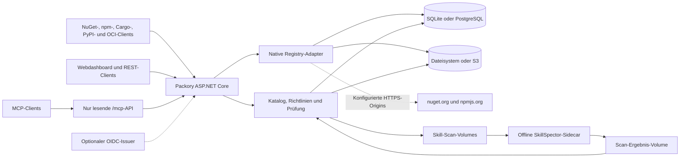

<picture>
  <source media="(prefers-color-scheme: dark)" srcset="docs/branding/banner-dark.svg">
  
</picture>

# Packory

**Marke und UI:** [Logo und Hell-/Dunkel-Designvorlagen](docs/branding/README.md) (ausschließlich Entwürfe).

**Sprache:** [English](README.md) · **Deutsch**

[](https://github.com/Cenn0/Packory/actions/workflows/ci.yml)
[](LICENSE)

**Direkt zu:** [Schnellstart](#schnellstart) · [Funktionen](#umgesetzte-funktionen) · [Architektur](#architektur-im-überblick) · [Dokumentation](docs/README.md) · [Roadmap V3](docs/roadmap.md) · [Roadmap V4](docs/roadmap-v4.md) · [Kompatibilitätsmatrix](docs/support-matrix.md)

**Eine selbst gehostete Distributionszentrale für Entwicklerpakete und KI-Agent-Skills.**


Packory bündelt native Registry-Schnittstellen, einen indexierten Artefaktkatalog und ein einfaches Webdashboard. Die aktuelle Implementierung ist ein modularer Monolith mit **ASP.NET Core / .NET 10**. SQLite und lokaler Dateispeicher sind der Standard; PostgreSQL als Metadatenspeicher und S3-kompatibler Objektspeicher sind optional. Ein Message-Broker oder Kubernetes sind nicht erforderlich. Erste Härtungen umfassen Artefakt-Sperren innerhalb eines Prozesses, reservierte private Namensräume, einen Abgleich des Dateispeichers beim Start, **transaktionale Audit-Einträge erfolgreicher Veröffentlichungen** und nach Tokenrolle getrennte Ratenbegrenzung für Schreibvorgänge.

> **Status: experimentelles Open-Source-Projekt.** Die Adapter und optionalen Speicher-Backends sind nur begrenzt getestet; vollständige Protokollkompatibilität, Recovery nach Migrationen und Mehrinstanzgarantien sind nicht nachgewiesen. Der Katalog zeigt lokal gehostete oder bereits gecachte Pakete, nicht den vollständigen Inhalt der Upstream-Registries.

## Schnellstart

Voraussetzung: Docker Compose. Für die lokale Erprobung:

```bash
git clone https://github.com/Cenn0/Packory.git
cd Packory
export PACKORY_ADMIN_TOKEN="$(openssl rand -hex 32)"
docker compose up -d --build
```

Öffne **http://localhost:8080/**. Der Token schaltet administrative Aktionen frei; lege ihn nicht in Git ab und veröffentliche ihn nicht in Issues. Die Compose-Konfiguration bindet an `127.0.0.1:8080` und speichert Daten dauerhaft im Volume `packory-data`.

Alternativ direkt mit dem .NET-10-SDK starten:

```bash
export PACKORY_ADMIN_TOKEN="$(openssl rand -hex 32)"
export PACKORY_PUBLIC_BASE_URL=http://localhost:8080
dotnet run --project src/Packory --urls http://localhost:8080
```

Vor einem Netzwerkzugriff oder der Einrichtung eines dauerhaften Datenverzeichnisses die [Betriebsanleitung](docs/operations.md) lesen.

## Umgesetzte Funktionen

| Bereich | Umgesetzter Umfang |
| --- | --- |
| **NuGet V3** | Service-Index, Paket-/Versionsdownloads, Read-through-Caching von nuget.org und Veröffentlichung eigener Pakete; experimentelle getrennte private NuGet-Feeds mit eigenen Berechtigungen |
| **npm** | Caching von Upstream-Metadaten und Tarballs, Scoped Packages und einfache Veröffentlichung einzelner Versionen |
| **OCI (experimentell)** | Distribution-v2-Endpunkte für SHA-256-Blobs, Uploads, Manifeste, Tags und Referrer; Client-/Auth-Abdeckung noch unvollständig |
| **Cargo & PyPI (experimentell)** | Cargo als gehostete Alternate Registry (Sparse Index und Upload), PyPI Simple API (HTML/JSON) und grundlegender Upload; keine vollständige Unterstützung |
| **Helm 3 über OCI (experimentell)** | Native Helm-OCI-Push/Pull/Show/Template-Smoke-Tests mit festgelegter CLI-Version; kein allgemeiner Helm- oder Kubernetes-Konformitätsnachweis |
| **Maven-Release-Dateien (experimentell)** | Globale unveränderliche Release-Dateien, POM-GAV-Prüfung, SHA-256, Versionsmetadaten und Maven-Verbrauchertest; kein Maven-Deploy, SNAPSHOT, Proxy oder separate Maven-Feeds |
| **Raw / Generic (experimentell)** | Binärdateien über HTTP mit SHA-256, Metadaten und Range-Downloads; globaler Namensraum, kein natives Paketmanager-Protokoll |
| **Agent Skills (experimentell)** | Versionierter ZIP-Import mit Quarantäne, offline statischer SkillSpector-Prüfung, expliziter Freigabe vor REST-/MCP-Auslieferung sowie Widerruf/erneuter Prüfung |
| **Packory MCP (experimentell)** | Authentifizierter, nur lesender Streamable-HTTP-Endpunkt `/mcp` mit Tools, Ressourcen, Prompts und Skills Extension; keine Ausführung fremder Skills |
| **MCP-Serververzeichnis (experimentell)** | Versionierte Remote-`server.json`-Metadaten, administrative Prüfung/Freigabe/Widerruf, nur lesende MCP-Tools und Dashboard-Suche. Keine externe Serverausführung und **keine verifizierte Herausgeberidentität**; [Details](docs/mcp-registry-catalog.md). |
| **Dashboard/API** | Durchsuchbarer Katalog gecachter/gehosteter Artefakte sowie Liveness-/Readiness-Endpunkte |
| **Zugriff** | Statische Read-/Write-/Admin-Tokens sowie optionale OIDC-JWT-Prüfung mit expliziten `packory.read`-, `packory.write`- und `packory.admin`-Scopes; noch kein Browser-SSO/BFF |
| **Speicher** | SQLite und Dateisystem standardmäßig; optional PostgreSQL-Metadaten und S3-kompatible Blobs für neue Einzelinstanz-Installationen |

**Go (V4 E3, keine Registry):** Ein kanonischer GOPROXY-Pfadparser und eine Offline-ZIP-Vorprüfung prüfen Pfade, Dateikollisionen, Symlinks, Größenlimits und ZIP-SHA-256. Es fehlen jedoch HTTP-Routen, Veröffentlichung/Persistenz, native Go-Clienttests, Prüfsummen-Datenbankregeln und private Go-Feeds. Die Vorarbeit ist **keine Go-Registry-Unterstützung**. Siehe [Go-Implementierungsstand](docs/go-proxy.md) und [Checkpoint vom 20. Oktober](docs/roadmap-status-2026-10-20.md).

### Packory als Paketquelle nutzen

NuGet-Service-Index: `http://localhost:8080/nuget/v3/index.json`.

```bash
# HTTP ausschließlich zur lokalen Entwicklung verwenden.
dotnet nuget add source http://localhost:8080/nuget/v3/index.json \
  --name packory --allow-insecure-connections

# npm-Registry nur für diesen Befehl verwenden.
npm install --registry=http://localhost:8080/npm/ lodash
```

Zum Veröffentlichen von Paketen wird ein passender Token benötigt. Die [API-Beispiele](docs/api.md) zeigen NuGet Push, npm-Veröffentlichung und ZIP-Import für Agent Skills, ohne Zugangsdaten in versionierten Dateien abzulegen. Bei aktivierter Skill-Sicherheitsrichtlinie werden ZIPs **zunächst isoliert und erst nach autorisierter Freigabe ausgeliefert**. Die statische Offline-Prüfung durch SkillSpector unterstützt die Begutachtung, **ist aber kein Nachweis für sicher ausführbare Skills**. Siehe [MCP-/SkillSpector-Integration](docs/mcp-security-integration.md) und [Roadmap-Status](docs/roadmap-status-2026-10-18.md).

## Architektur im Überblick



NuGet und npm behalten ihre **eigenen Protokolle**, teilen sich aber Katalog und Speicher. Prozesslokale Sperren und Audit-Einträge sind keine Mehrinstanz- oder verteilte ACID-Garantie. Siehe [Cargo & PyPI](docs/cargo-pypi.md) · [OCI](docs/oci.md) · [OIDC / Keycloak](docs/oidc-keycloak.md) · [PostgreSQL](docs/operations.md#postgresql-metadata-backend) · [S3](docs/s3.md) · [Architektur](docs/architecture.md).

## Einschränkungen und Sicherheit

- NuGet und npm unterstützen wesentliche Registry-Abläufe, aber **nicht alle Protokollfunktionen**. Die konkret verwendeten Clients und Versionen müssen getestet werden.
- Die Suche umfasst nur lokal indexierte Artefakte. Aktuelle Upstream-Metadaten und noch nicht gecachte Downloads können Netzwerkzugriff benötigen.
- Statische Tokens sind keine individuellen Benutzerkonten. **OIDC-JWT-Prüfung ist implementiert; Browser-SSO/BFF, paketbezogene Rechte, persönliche Akteurszuordnung, vollständige/unveränderbare Audit-Protokolle und Hochverfügbarkeit fehlen noch.** Das vorhandene Admin-Audit erfasst **erfolgreiche Veröffentlichungen**, aber weder alle Aktionen noch verweigerte Versuche.
- Konfigurierbare private NuGet-ID-Präfixe und npm-Scopes können einen Rückgriff auf öffentliche Registries für reservierte Namensräume verhindern. Das ist **keine vollständige Paket- oder Malware-Sicherheitsrichtlinie**. Signaturdurchsetzung, Cache-Eviction und automatische Lizenzkonformitätsprüfung fehlen weiterhin.
- **Cargo, PyPI, OCI und globale Maven-Release-Dateien sind experimentell implementiert.** PostgreSQL und S3 sind auswählbare Backends; automatische Datenmigration und verteilte DB-/Blob-Transaktionen fehlen. Ein eingeschränkter lesender Mehrinstanzmodus existiert, **mehrere gleichzeitig schreibende Instanzen sind nicht unterstützt**.

Nach Tokenrolle begrenzte Schreibzugriffe ergänzen die Schutzmaßnahmen, **ersetzen aber keine Ratenbegrenzung am Reverse-Proxy**. Sperren innerhalb eines Prozesses garantieren **keine Konsistenz über mehrere Instanzen**. Der Speicherabgleich beim Start kann ausgewählte inkonsistente Artefakte erkennen oder isolieren, ersetzt aber keine geprüften Backups. Der Standard-Docker-Port ist nur über Loopback erreichbar. Für gemeinsame Installationen sind HTTPS und explizite Zugriffskontrollen erforderlich. Tokens sicher verwahren, Logging und Upstream-Netzwerkzugriff prüfen sowie **Metadatenbank und Artefaktspeicher konsistent** sichern. Nicht vertrauenswürdige Skills oder Pakete dürfen nicht auf dem Server ausgeführt werden. Siehe [Sicherheit und Betrieb](docs/operations.md).

## Build und Tests

```bash
dotnet restore Packory.slnx
dotnet build Packory.slnx -c Release --no-restore
dotnet test Packory.slnx -c Release --no-build
node --check src/Packory/wwwroot/app.js
# Benötigt .NET 10 SDK, Node.js/npm, curl und OpenSSL:
bash scripts/smoke-hosted.sh
bash scripts/smoke-ecosystems.sh
```

Die [CI](.github/workflows/ci.yml) führt Build-, Integrations- und [echte CLI-Veröffentlichungstests](scripts/smoke-hosted.sh) aus: `dotnet nuget push` mit anschließendem isoliertem `dotnet restore/build` sowie `npm publish` für ein Scoped Package mit anschließendem `npm install` und `npm ci` in einem frischen Cache. Zugangsdaten entstehen nur temporär im Test. Die CI testet zusätzlich Cargo Publish/Consumption, einen echten pip-Installationslauf mit gehosteter transitiver Abhängigkeit und einen Docker-OCI-Push/Pull-Test mit lokal erstelltem Scratch-Image. Ein [separater Live-Smoke-Workflow](.github/workflows/smoke-live.yml) prüft öffentliche Upstream-Registries. Ein bestandener CLI-Test bedeutet noch keine vollständige Protokollkompatibilität.

## Dokumentation und Mitwirkung

[Dokumentationsindex](docs/README.md) · [Go-Vorprüfung](docs/go-proxy.md) · [Maven](docs/maven.md) · [Raw / Generic](docs/raw-registry.md) · [Support-Matrix](docs/support-matrix.md) · [Roadmap V4](docs/roadmap-v4.md) · [Architektur](docs/architecture.md) · [API](docs/api.md) · [Betrieb](docs/operations.md) · [Roadmap](docs/roadmap.md) · [Mitwirken](CONTRIBUTING.md) · [Sicherheitsrichtlinie](SECURITY.md)

Lizenziert unter [Apache-2.0](LICENSE). Beiträge und öffentliche Fehlermeldungen sind willkommen. Sicherheitslücken über den vertraulichen Meldeweg der Sicherheitsrichtlinie melden.
