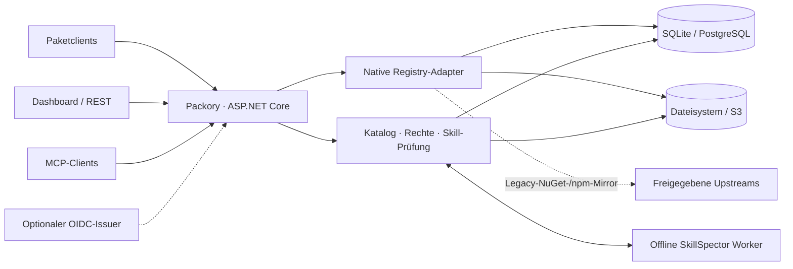

<picture>
  <source media="(prefers-color-scheme: dark)" srcset="docs/branding/banner-dark.svg">
  
</picture>

# Packory

**Eine selbst gehostete Zentrale für Entwicklerpakete, Artefakte und KI-Agent-Skills.**

[](https://github.com/Cenn0/Packory/actions/workflows/ci.yml)
[](LICENSE)
[](src/Packory/Packory.csproj)

[English](README.md) · **Deutsch**

[Schnellstart](#schnellstart) · [Funktionsumfang](#funktionsumfang) · [Architektur](#architektur-im-überblick) · [Dokumentation](docs/README.md) · [Projektstatus](docs/project-status.md) · [Roadmap](docs/roadmap-v5.md)

Packory vereint native Paket-Registries, private Hosted-Feeds, einen indexierten Artefaktkatalog, geprüfte Agent Skills und MCP-Discovery in einer Anwendung mit Webdashboard. Technisch ist Packory ein **modularer Monolith auf .NET 10**: Für die lokale Erprobung sind weder Message-Broker noch Kubernetes oder Microservices notwendig.

> **Entwicklungsstand vom 23. Oktober 2026:** Zentrale Abläufe sind für *konkrete* Client-/Speicherkombinationen implementiert und getestet. Eine allgemeine **Produktionsfreigabe liegt nicht vor**. Die [Support-Matrix](docs/support-matrix.md) trennt Implementierung und nachgewiesene Kompatibilität; die [Release-Gates](docs/release-gates.md) nennen offene Voraussetzungen.

## Warum Packory?

| Eine Zentrale für mehrere Ökosysteme | Native Abläufe statt bloßem Datei-Upload | Skills mit expliziter Freigabe |
| --- | --- | --- |
| Lokal gehostete und gecachte Artefakte über einen gemeinsamen Katalog auffinden. | Eigene Registry-Routen erhalten Protokollsemantik, Rechte und Beschränkungen. | Versionierte Skills zunächst prüfen und unter der aktiven Sicherheitsrichtlinie erst nach Freigabe verteilen. |
| [Katalog und APIs](docs/api.md) | [Protokollsupport](docs/support-matrix.md) | [Skill-Sicherheit](docs/mcp-security-integration.md) |

## Schnellstart

**Voraussetzungen:** Docker Engine mit Compose und OpenSSL. Diese Konfiguration dient der **lokalen Erprobung**.

```bash
git clone https://github.com/Cenn0/Packory.git
cd Packory
export PACKORY_ADMIN_TOKEN="$(openssl rand -hex 32)"
docker compose up -d --build
```

Das Dashboard ist unter **http://localhost:8080/** erreichbar. Die Compose-Konfiguration bindet den Port an `127.0.0.1:8080` und verwendet persistente Docker-Volumes. Den generierten Admin-Token niemals in Git, Screenshots, Issues oder Logs veröffentlichen.

<details>
<summary>Ohne Docker starten oder vorgebaute Entwicklungsimages verwenden</summary>

Mit dem **.NET-10-SDK**:

```bash
export PACKORY_ADMIN_TOKEN="$(openssl rand -hex 32)"
export PACKORY_PUBLIC_BASE_URL=http://localhost:8080
dotnet run --project src/Packory --urls http://localhost:8080
```

Für **GHCR-Entwicklungsimages** statt eines lokalen Builds siehe [Containerimages und Bereitstellung](docs/container-images.md). Eine erfolgreiche Veröffentlichung nach `main` führt nicht automatisch zu einem Deployment.

</details>

Vor einem längerfristigen oder von außen erreichbaren Betrieb zunächst die [Betriebsanleitung](docs/operations.md) lesen. Lokale HTTP-Beispiele sind **keine sichere Internetkonfiguration**.

### Registry ausprobieren

```bash
# NuGet-V3-Service-Index (nur lokale HTTP-Erprobung)
dotnet nuget add source http://localhost:8080/nuget/v3/index.json \
  --name packory --allow-insecure-connections

# Paket über Packorys npm-Endpunkt auflösen
npm install --registry=http://localhost:8080/npm/ lodash
```

Für Veröffentlichungen sind passende Berechtigungen notwendig. Ein Administrator erstellt und aktiviert einen privaten Feed und vergibt exakt `feed:{id}:read` bzw. `feed:{id}:publish`. Anfragen an private Hosted-Feeds fallen **nicht** auf öffentliche Upstreams zurück. Siehe [Feed-Einrichtung](docs/feeds.md) und [API-Beispiele](docs/api.md).

## Funktionsumfang

| Bereich | Aktuell vorhanden | Wichtige Grenze |
| --- | --- | --- |
| **NuGet · npm** | Hosted-Registries und begrenztes Read-through-Caching vertrauenswürdiger Origins; private Feeds | Keine vollständige Protokollparität |
| **Cargo · PyPI** | Native Hosted-Publish-/Installationsprofile einschließlich privater Feeds | Begrenzte Clientversionen und Metadatenvarianten |
| **OCI · Helm** | Hosted Images/Charts, Blobs, Manifeste, fortsetzbare Uploads und referenzierte Artefakte | Kein umfassender OCI-/Kubernetes-Konformitätsnachweis |
| **Maven · Gradle** | Hosted Releases, zeitgestempelte SNAPSHOTs und native Auflösung | Kein Upstream-Proxy und keine atomare Mehrdateiveröffentlichung |
| **Go-Module** | Hosted-GOPROXY-Downloads und authentifizierte Importe | Kein Upstream-Mirror oder Vertrauenspfad zu öffentlicher Prüfsummendatenbank |
| **Raw / Generic** | Unveränderliche Dateien, Digest-Metadaten, Range-Downloads und private logische Quoten | HTTP-Artefakte, **kein** Paketmanager-Protokoll |
| **Agent Skills** | ZIP-Staging, offline SkillSpector-Review, Freigabe/Widerruf und statische Qualitätsberichte | Freigabe und Analyse beweisen keine sichere Ausführung |
| **Optionale KI-Skill-Prüfung** | Zuschaltbare LLM-Zusatzanalyse mit Betreiberkonfiguration und auditierter Richtlinie | Experimentell, externe Datenübertragung; menschliche Freigabe bleibt notwendig |
| **MCP** | Authentifizierte, nur lesende `/mcp`-Discovery, Tools, Ressourcen, Skills Extension und geprüfte inerte Registry-Metadaten | Keine private Feed-MCP-Suche, Gateway-Ausführung oder Herausgeberverifikation |
| **Identität & Speicher** | Statische/verwaltete Tokens, optionales OIDC-JWT; SQLite/Dateisystem oder PostgreSQL/S3 | Kein Browser-SSO/BFF, keine mehreren aktiven Writer, kein abgenommener Real-Provider-DR-Prozess |

Diese Aussagen beschreiben **begrenzte Implementierungen**, keine Zertifizierung durch Hersteller. Details und Tests: [Support-Matrix](docs/support-matrix.md) · [MCP-Roadmap](docs/mcp-roadmap.md) · [KI-Prüfung](docs/skill-ai.md).

## Architektur im Überblick



**Eine Anwendung mit protokollspezifischen Adaptern und geteilter Infrastruktur.** PostgreSQL und S3 können optional eingesetzt werden. Ein eng begrenzter Reader-Modus existiert, aber **mehrere aktive Writer werden nicht unterstützt**. Datenbank und Blob-Store bilden keine gemeinsame verteilte ACID-Transaktion. Siehe [Architektur](docs/architecture.md), [Betrieb](docs/operations.md) und [Release-/Recovery-Gates](docs/release-gates.md).

## Sicherheit und Betriebsgrenzen

- **Lokaler Katalog statt föderierter Suche:** sichtbar sind ausschließlich bereits gehostete oder gecachte Artefakte.
- **Keine automatische Vertrauensübernahme:** SkillSpector und optionale KI-Befunde unterstützen menschliche Entscheidungen. Sie garantieren weder sichere Skills noch geprüfte MCP-Server.
- **Zugangsdaten und Netz:** Tokens im Secret-Management schützen; für gemeinsame Installationen HTTPS, minimale Rechte, Proxy-Limits und kontrollierten Upstream-Egress verwenden. Private Feed-Grants gelten nicht automatisch global.
- **Recovery ist noch nicht qualifiziert:** Metadaten- und Blob-Backups abgestimmt erstellen, isolierte Wiederherstellung proben und Providergrenzen beachten. Moto-Tests sind kein Real-S3-Nachweis.
- **Keine allgemeine Produktions- oder HA-Zusage:** Browser-SSO/BFF, verteiltes Fencing, unabhängige Sicherheits- und Supply-Chain-Prüfung sowie Betriebsabnahme bleiben offen.

Vor einer Deploymententscheidung: [Sicherheitsrichtlinie](SECURITY.md), [Betrieb](docs/operations.md), [Projektstatus](docs/project-status.md) und [Release-Gates](docs/release-gates.md).

## Entwicklung und Beiträge

```bash
dotnet restore Packory.slnx
dotnet build Packory.slnx -c Release --no-restore -warnaserror
dotnet test Packory.slnx -c Release --no-build
node --check src/Packory/wwwroot/app.js
python3 scripts/check_public_docs.py
python3 scripts/check_public_privacy.py
```

Native Client- und Provider-Smoke-Tests haben zusätzliche Voraussetzungen. Die [CI-Qualifikation](docs/ci-qualification.md) beschreibt die notwendige Prüfung; ein lokaler Build genügt nicht als Abnahme.

**Weiterlesen:** [Dokumentationszentrale](docs/README.md) · [Mitwirken](CONTRIBUTING.md) · [Aktuelle Roadmap](docs/roadmap-v5.md) · [Branding](docs/branding/README.md)

Packory ist unter [Apache-2.0](LICENSE) quelloffen. Öffentliche Meldungen dürfen keine personenbezogenen Daten, privaten Artefakte oder Secrets enthalten; Sicherheitsprobleme über den vertraulichen Meldeweg in [SECURITY.md](SECURITY.md) melden.
