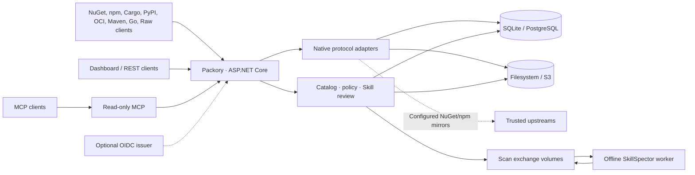

<picture>
  <source media="(prefers-color-scheme: dark)" srcset="docs/branding/banner-dark.svg">
  
</picture>

# Packory

**A self-hosted distribution hub for developer packages, artifacts and AI Agent Skills.**

[](https://github.com/Cenn0/Packory/actions/workflows/ci.yml)
[](LICENSE)

**Language:** English · [Deutsch](README.de.md)  
**Explore:** [Docker quick start](#docker-quick-start) · [Capabilities](#capabilities) · [Architecture](#architecture-at-a-glance) · [Documentation](docs/README.md) · [Compatibility](docs/support-matrix.md) · [Roadmap](docs/roadmap-v5.md)

Packory provides native endpoints for **NuGet, npm, Cargo, PyPI, OCI/Helm, Maven/Gradle, Go and Raw** alongside reviewed Agent Skills and read-only MCP discovery. Its current implementation is a **.NET 10 / ASP.NET Core modular monolith**, with one integrated dashboard and shared authorization, catalog and storage services. SQLite and filesystem storage are the defaults; PostgreSQL and S3-compatible storage are optional.

> **Project status: active development, not a production-certified platform.** Features are implemented and tested in explicitly bounded configurations. Protocol interoperability, real-provider recovery and multi-node guarantees remain limited. Consult the [support matrix](docs/support-matrix.md), [release gates](docs/release-gates.md) and [23 October 2026 review](docs/review-2026-10-23.md) before depending on a feature.

## Docker quick start

**Prerequisites:** Docker Engine with Docker Compose v2, Git and a POSIX-compatible shell with OpenSSL (plus curl for the readiness check). The commands below are for **local evaluation**, not a public deployment.

### Option A — Build locally

```bash
git clone https://github.com/Cenn0/Packory.git
cd Packory
export PACKORY_ADMIN_TOKEN="$(openssl rand -hex 32)"
docker compose up -d --build
```

This builds the Packory application and its **network-isolated SkillSpector scanner** from the repository. Open **http://localhost:8080/**. The Compose port is restricted to `127.0.0.1:8080`; the named `packory-data` volume persists the registry data.

### Option B — Use prebuilt GHCR images

From the same cloned repository, with `PACKORY_ADMIN_TOKEN` set:

```bash
docker compose -f compose.ghcr.yaml pull
docker compose -f compose.ghcr.yaml up -d --no-build
```

This uses `ghcr.io/cenn0/packory:main` and `ghcr.io/cenn0/packory-skillspector:main`. **Both development images must have been successfully published and made publicly readable**; the presence of a workflow is not proof that an image is available. For release gates, exact SHA/digest pinning and upgrades, read [Container images](docs/container-images.md). Do not mix independently updated image revisions.

### Check, inspect and stop

```bash
# Use the same -f compose.ghcr.yaml prefix here if you chose option B.
docker compose ps
curl -fsS http://localhost:8080/health/ready
docker compose logs --tail=100 packory
```

To stop the stack later (for option B, add `-f compose.ghcr.yaml`):

```bash
docker compose down
```

A readiness response indicates the configured application is ready, **not** that its production deployment or external providers have been certified. `docker compose down` preserves named volumes; `down -v` **deletes the stored registry data**. Never commit, log or paste the admin token into public issues.

**Before exposing Packory to a network:** configure HTTPS, the public base URL, managed secrets, least-privilege access and verified backups using the [operations guide](docs/operations.md). Default anonymous package reads are enabled for local evaluation.

### Alternative — Run with the .NET SDK

```bash
export PACKORY_ADMIN_TOKEN="$(openssl rand -hex 32)"
export PACKORY_PUBLIC_BASE_URL=http://localhost:8080
dotnet run --project src/Packory --urls http://localhost:8080
```

This launches the app only. Use the Docker Compose stack when you also need the offline SkillSpector worker.

## Capabilities

| Area | What is available | Details and boundaries |
| --- | --- | --- |
| **NuGet / npm** | Hosted packages and read-through caches for configured upstreams; native clients and private feeds | [Support matrix](docs/support-matrix.md) · [Feed setup](docs/feeds.md) |
| **Cargo / PyPI** | Private hosted native registries with bounded publish/install workflows | [Cargo & PyPI](docs/cargo-pypi.md) |
| **OCI / Helm** | Hosted blobs, manifests, tags, resumable uploads; tested Helm OCI flows | [OCI](docs/oci.md) |
| **Maven / Gradle** | Hosted releases and timestamped SNAPSHOTs; native deploy/consumption profiles | [Maven](docs/maven.md) |
| **Go modules** | Authenticated import and hosted GOPROXY reads, without an upstream mirror | [Go](docs/go-proxy.md) |
| **Raw artifacts** | Immutable generic files with hashes, byte-range reads and private feed quotas | [Raw](docs/raw-registry.md) |
| **Agent Skills** | ZIP staging, offline SkillSpector inspection, approval/revocation and static quality findings | [Skill security](docs/mcp-security-integration.md) · [Quality](docs/skill-quality.md) |
| **Optional AI review** | Opt-in LLM assessment with separate networkless worker and operator-controlled provider access; human approval remains required | [Skill AI](docs/skill-ai.md) |
| **MCP discovery** | Authenticated read-only `/mcp`, global catalog traversal and approved Skill access; reviewed inert MCP Registry descriptors | [MCP roadmap](docs/mcp-roadmap.md) · [Registry catalog](docs/mcp-registry-catalog.md) |
| **Platform** | Dashboard, REST API, exact private-feed grants, optional OIDC JWT validation, SQLite/filesystem or PostgreSQL/S3 | [API](docs/api.md) · [Operations](docs/operations.md) |

**Private hosted E0:** isolated native feed routes for all eight package kinds are implemented with explicit activation and exact `feed:{id}:read` or `feed:{id}:publish` grants. Private requests do not fall back to global or upstream packages. The [E0 acceptance record](docs/e0-acceptance.md) is evidence for its named test versions and providers, **not** a blanket interoperability or production claim. Proxy/group feeds, private Skills and feed-aware MCP discovery remain separate work.

### Try a local registry

```bash
# Only use HTTP for loopback development.
dotnet nuget add source http://localhost:8080/nuget/v3/index.json \
  --name packory --allow-insecure-connections
npm install --registry=http://localhost:8080/npm/ lodash
```

Publishing requires the appropriate token and namespace/feed grants. See the [API examples](docs/api.md) and [feed lifecycle guide](docs/feeds.md). Imported Skills subject to the enforcing policy are not distributed before authorized review; neither a static nor an optional AI assessment certifies that a Skill is safe to execute.

## Architecture at a glance



Packory is **not** currently a microservices deployment. Protocol adapters share persistence and policy infrastructure but preserve their native wire formats. Schema upgrades, cross-store consistency, scan isolation and the restricted reader profile are explained in [Architecture](docs/architecture.md) and [Operations](docs/operations.md). A single-writer lease is **not** multi-writer fencing or distributed ACID.

## Important limits

- Native-client tests qualify **specific protocols, operations, versions and storage profiles**, not official upstream vendor endorsement or full specification compliance.
- Static tokens and optional OIDC JWT validation do **not** provide browser SSO/BFF, complete individual attribution, comprehensive immutable audit or granular per-package permissions.
- PostgreSQL/S3 integration is experimental and real-provider recovery remains a release gate. **Multiple active writers are not supported**; reader replicas have a deliberately restricted endpoint allowlist.
- Package integrity checks, static Skill inspection and AI review are not malware certification, provenance validation or safe-execution guarantees.
- Keep the deployment loopback-only for evaluation. A shared installation needs TLS, explicit access policy, egress controls, least-privilege credentials and coherent **database plus blob-store backups**.

See [Security](SECURITY.md), [Support matrix](docs/support-matrix.md) and [Release gates](docs/release-gates.md) for authoritative boundaries.

## Develop and contribute

```bash
dotnet restore Packory.slnx
dotnet build Packory.slnx -c Release --no-restore -warnaserror
dotnet test Packory.slnx -c Release --no-build
node --check src/Packory/wwwroot/app.js
python3 scripts/check_public_docs.py
python3 scripts/check_public_privacy.py
```

Native integration/smoke test commands and exact evidence are listed in [CI qualification](docs/ci-qualification.md), [Support matrix](docs/support-matrix.md) and [E0 acceptance](docs/e0-acceptance.md). Local tests do not replace CI and provider-specific release checks.

**Next steps:** [Documentation hub](docs/README.md) · [Architecture](docs/architecture.md) · [API](docs/api.md) · [Operations](docs/operations.md) · [Current roadmap V5](docs/roadmap-v5.md) · [Contributing](CONTRIBUTING.md).

Licensed under [Apache-2.0](LICENSE). Submit security reports through the private channel in [SECURITY.md](SECURITY.md); this public repository must never contain personal contact data, secrets or production artifacts.
