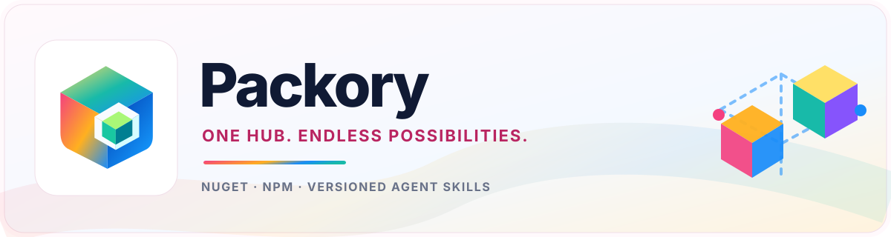
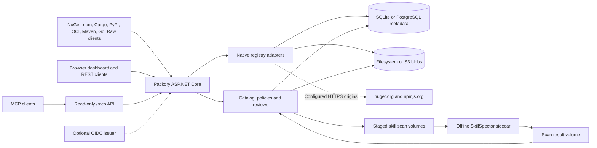

<picture>
  <source media="(prefers-color-scheme: dark)" srcset="docs/branding/banner-dark.svg">
  
</picture>

# Packory

**Brand and UI design:** [Logo + light/dark templates](docs/branding/README.md) (design concepts only).

**Language:** **English** · [Deutsch](README.de.md)

[](https://github.com/Cenn0/Packory/actions/workflows/ci.yml)
[](LICENSE)

**Explore:** [Quick start](#quick-start) · [Capabilities](#implemented-capabilities) · [Architecture](#architecture-overview) · [Docs](docs/README.md) · [Roadmap V3](docs/roadmap.md) · [Roadmap V4](docs/roadmap-v4.md) · [MCP roadmap](docs/mcp-roadmap.md) · [Go hosted registry](docs/go-proxy.md) · [Support matrix](docs/support-matrix.md) · [Security](SECURITY.md)

**A self-hosted distribution hub for developer packages and AI agent skills.**


Packory combines native package-registry endpoints, an indexed artifact catalog and a small web dashboard. The current implementation is an **ASP.NET Core / .NET 10 modular monolith**. SQLite and filesystem storage remain the default; PostgreSQL metadata storage and S3-compatible object storage are optional. No broker or Kubernetes cluster is required. Milestone-1 hardening includes single-process artifact locks, reserved private namespaces, startup storage reconciliation, **transactional audit records for successful hosted publishing**, and role-partitioned publish rate limiting.

> **Status: active development with documented functional profiles.** Registry adapters and optional backends have bounded test coverage; full protocol interoperability, migration recovery and multi-node guarantees remain incomplete. The catalog lists packages already hosted or cached by Packory, not the complete upstream registries. See the [support matrix](docs/support-matrix.md) for each implemented and tested scope.

**E0 private hosted feeds are implemented for NuGet, npm, Cargo, PyPI, OCI, Maven, Go and Raw.** Each active feed has its own native routes, exact read/publish grants and immutable artifact identity; private requests never fall back to global packages or upstreams. Acceptance for the current change is still pending the complete CI and provider/recovery gates recorded in [E0 acceptance](docs/e0-acceptance.md). Proxy/group feeds, private Skills and feed-aware MCP discovery remain separate work.

## Quick start

Requires Docker Compose. For local evaluation:

```bash
git clone https://github.com/Cenn0/Packory.git
cd Packory
export PACKORY_ADMIN_TOKEN="$(openssl rand -hex 32)"
docker compose up -d --build
```

Open **http://localhost:8080/**. The token enables administrative actions; do not commit it or paste it into issues. The example Compose configuration binds to `127.0.0.1:8080` and persists data in the `packory-data` volume.

To run directly with the .NET 10 SDK instead:

```bash
export PACKORY_ADMIN_TOKEN="$(openssl rand -hex 32)"
export PACKORY_PUBLIC_BASE_URL=http://localhost:8080
dotnet run --project src/Packory --urls http://localhost:8080
```

See [operations](docs/operations.md) before enabling network access or choosing a permanent data directory.

## Implemented capabilities

| Area | Implemented scope |
| --- | --- |
| **NuGet V3** | Service index, package/version downloads, read-through caching from nuget.org, registration metadata and basic hosted publishing; experimental private hosted NuGet feeds with separate tokens and immutable SHA-512 |
| **npm** | Legacy metadata/tarball caching plus private hosted scoped/unscoped publish, packuments, publication tags and verified tarballs; native install/ci |
| **OCI (experimental)** | Legacy and private hosted Distribution v2 blobs, durable chunk uploads, manifests, mutable tags and referrers; private repositories use `/v2/feeds/{id}/` |
| **Cargo & PyPI (experimental)** | Legacy and private hosted Cargo sparse registries/native publish; PyPI Simple HTML/JSON and Twine upload with immutable distribution files |
| **Maven (experimental)** | Global and private immutable release files, POM identity checks, checksums and generated version metadata; native dependency consumption, no native deploy, SNAPSHOT or proxy |
| **Go modules (hosted experimental)** | Global and private authenticated import/native GOPROXY reads; immutable module triplets and canonical `h1:` content hashes; no upstream mirror or external checksum-database trust |
| **Raw / Generic (experimental)** | Global and private immutable HTTP upload/download with SHA-256 metadata and ranged reads; generic bytes, without a package-manager protocol |
| **Agent Skills** | Staged versioned ZIP imports; offline static SkillSpector assessment; explicit reviewer approval before REST/MCP discovery or download under the enforcing policy; revocation and rescan |
| **Static Skill quality** | Deterministic documentation findings, improvement suggestions and coverage for immutable published Skills through MCP, REST and dashboard; separate from safety and behavior checks |
| **Packory MCP** | Authenticated read-only Streamable HTTP `/mcp` tools, resources, prompts and Skills Extension; paginated global artifact/version discovery including Maven and Raw |
| **MCP Registry catalog** | Stage/review/revoke immutable inert remote/package `server.json` metadata; three `/v0.1` read routes, MCP discovery tools and paginated dashboard; no remote execution or publisher ownership verification |
| **Dashboard/API** | Searchable catalog of cached/hosted artifacts, MCP server discovery, Skill quality inspection and liveness/readiness endpoints |
| **Access** | Static read/write/admin tokens and optional OIDC JWT validation with explicit `packory.read`, `packory.write` and `packory.admin` scopes; no browser SSO/BFF |
| **Storage** | SQLite + filesystem by default; optional PostgreSQL metadata and S3-compatible blob backends for fresh single-node installations |

**Private hosted profile:** create a disabled draft, explicitly activate it as an administrator and issue an exact `feed:{id}:read` or `feed:{id}:publish` managed grant. Most roots are `/feeds/{id}/{protocol}/`; OCI preserves its native `/v2/` prefix at `/v2/feeds/{id}/{repository}/`. Legacy roots remain available, with OCI repository prefix `feeds/` reserved for private routing. See [feed lifecycle, client setup and protocol limits](docs/feeds.md).

Private npm supports tags supplied during publication, without a separate mutable tag/unpublish API. Private Cargo has no yank API. Private PyPI accepts a bounded canonical PEP 440 version profile without epochs; native evidence covers wheels and rejects direct dependency URLs. Maven supports immutable release uploads and consumption, without `mvn deploy` or SNAPSHOT. Go requires HTTPS for native GOAUTH credentials and has no upstream mirror or checksum-database verification. The [support matrix](docs/support-matrix.md) records exact tested clients and remaining scope.

### Use Packory as a registry

NuGet service index: `http://localhost:8080/nuget/v3/index.json`.

```bash
# HTTP is appropriate only for local development.
dotnet nuget add source http://localhost:8080/nuget/v3/index.json \
  --name packory --allow-insecure-connections

# Use the local npm registry for one command.
npm install --registry=http://localhost:8080/npm/ lodash
```

Publish operations require an appropriate token. [API examples](docs/api.md) explain NuGet push, npm publishing and agent-skill ZIP imports without placing credentials in tracked files. With skill security enforcement enabled, imports are **staged and unavailable for distribution until an authorized approval**. Offline static SkillSpector inspection is an input to human review, **not proof that a skill is safe to execute**. The [MCP and SkillSpector implementation](docs/mcp-security-integration.md) and [20 October delivery checkpoint](docs/roadmap-status-2026-10-20.md) describe the runtime contract and remaining work.

### MCP discovery and Skill quality

Connect an authorized MCP client to `/mcp` to search global artifacts, traverse package versions and read published Skills. Native C# SDK tests cover protocol revisions **2025-06-18, 2025-11-25 and 2026-07-28**. Opaque cursors support complete catalog, Skill and directory traversal beyond the former 100-row catalog limit, including Maven and Raw artifacts. Private feed records remain outside the global MCP catalog. The [MCP Registry catalog](docs/mcp-registry-catalog.md) separately exposes reviewed inert remote and package server descriptors through the three `/v0.1` read routes, Packory's management API and the dashboard.

Use **`assess_skill_quality(name, version)`**, `GET /api/v1/skills/{name}/{version}/quality`, or **Assess quality** in the dashboard for static documentation checks. The report contains independent findings, concrete suggestions, exact source digests and incomplete-coverage indicators. It checks frontmatter, instruction text and recognized local Markdown references without running imported code or contacting external services. A completed report can contain defects; it does not certify safety, publisher identity or functional correctness. See [Static Skill quality](docs/skill-quality.md) for the profile, limits and authorization rules.

The [MCP delivery roadmap](docs/mcp-roadmap.md) separates the delivered functions from publisher ownership proof, signature verification, upstream synchronization, broader manifests, additional SDK conformance and per-feed discovery. Behavioral agent/connector testing and an external MCP gateway require their own isolated execution boundaries and acceptance tests.

## Architecture overview



Each adapter keeps its own native protocol while sharing authorization, persistence and recovery. Schema V10 includes the private artifact ledger and OCI tag references; npm/Cargo/PyPI commit protocol metadata and original package bytes in one verified immutable bundle. In-process coordination and hosted-publish auditing are not multi-node or distributed ACID guarantees. See [architecture](docs/architecture.md).

## Limitations and security

- NuGet and npm support useful registry flows, but **not full protocol parity**. Verify your exact client/version/workflow before relying on Packory.
- Search covers locally indexed artifacts. Fresh upstream metadata and uncached downloads may require connectivity.
- Static tokens are not individual user accounts. **OIDC JWT validation is implemented but browser SSO/BFF, per-package permissions, individual actor attribution, a comprehensive/immutable audit trail and high availability are not implemented.** The admin-only log records successful hosted publishes and selected management events, including feed lifecycle changes; it does not cover every request or denied attempt.
- Reserved NuGet ID prefixes and npm scopes can prevent configured private namespaces from falling back to public upstreams. This is **not** a comprehensive package-policy or malware-scanning solution. Signature enforcement, cache eviction and automatic license compliance are also absent.
- Private hosted feeds have independent grants and storage identities. Proxy/group routing, private Skills, feed-scoped MCP discovery, per-feed capacity accounting and browser permission management remain open.
- **Native adapters have bounded functional profiles.** PostgreSQL and S3 are selectable backends. Automatic SQLite-to-PostgreSQL/filesystem-to-S3 migration and distributed DB/blob transactions are absent. A constrained PostgreSQL/S3 read-only multi-instance profile is tested; **multiple active writers are not supported**.

Per-role in-process publish throttling complements, but **does not replace, proxy-level rate limits**. Single-process locks do **not** provide multi-node consistency. Startup reconciliation can detect or quarantine selected inconsistent artifacts; it does not replace verified backups. The default Docker port is loopback-only. For any shared deployment, use HTTPS and explicit access controls; keep tokens in a secrets manager, review logging and upstream network access, and back up **the selected metadata database and artifact storage consistently**. Do not execute untrusted skills or packages on the server. See [security and operations](docs/operations.md).

## Build and test

```bash
dotnet restore Packory.slnx
dotnet build Packory.slnx -c Release --no-restore
dotnet test Packory.slnx -c Release --no-build
node --check src/Packory/wwwroot/app.js
# Requires the .NET 10 SDK, npm/Node.js, curl and OpenSSL:
bash scripts/smoke-hosted.sh
bash scripts/smoke-ecosystems.sh
```

[CI](.github/workflows/ci.yml) runs builds, deterministic integration tests and a [native-client hosted smoke test](scripts/smoke-hosted.sh): a real `dotnet nuget push` followed by an isolated `dotnet restore/build`, plus a scoped `npm publish` followed by `npm install` and fresh-cache `npm ci`. Test credentials are generated temporarily and never committed. CI also exercises native Cargo publish/consume, a pip installation with a hosted transitive dependency, and one Docker OCI push/pull scenario using a local scratch image. A [separate live mirror workflow](.github/workflows/smoke-live.yml) checks upstream registry behavior; passing one native hosted scenario does not imply comprehensive protocol support.

The private-feed harness adds two feeds containing different bytes under identical coordinates, exact credential denials, empty client caches and restart checks where specified. [E0 acceptance](docs/e0-acceptance.md) maps every adapter to its tests and commands, distinguishes local results from pending CI/provider runs, and lists the exact client versions observed.

## Documentation and contributions

[Documentation index](docs/README.md) · [MCP roadmap](docs/mcp-roadmap.md) · [Skill quality](docs/skill-quality.md) · [Go hosted registry](docs/go-proxy.md) · [Cargo & PyPI](docs/cargo-pypi.md) · [OCI](docs/oci.md) · [OIDC / Keycloak](docs/oidc-keycloak.md) · [PostgreSQL](docs/operations.md#postgresql-metadata-backend) · [S3](docs/s3.md) · [Architecture](docs/architecture.md) · [API](docs/api.md) · [Operations](docs/operations.md) · [Roadmap](docs/roadmap.md) · [Roadmap V4](docs/roadmap-v4.md) · [Support matrix](docs/support-matrix.md) · [Contributing](CONTRIBUTING.md) · [Security policy](SECURITY.md)

Licensed under [Apache-2.0](LICENSE). Contributions and public bug reports are welcome; report security vulnerabilities using the private channel described in the security policy.
