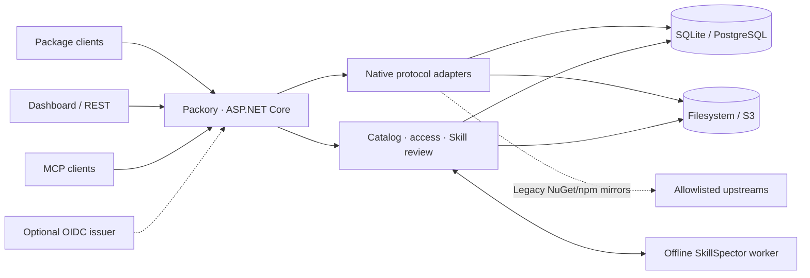

<picture>
  <source media="(prefers-color-scheme: dark)" srcset="docs/branding/banner-dark.svg">
  
</picture>

# Packory

**One self-hosted hub for packages, artifacts and AI agent skills.**

[](https://github.com/Cenn0/Packory/actions/workflows/ci.yml)
[](LICENSE)
[](src/Packory/Packory.csproj)

**English** · [Deutsch](README.de.md)

[Get started](#get-started) · [What it supports](#capabilities) · [Architecture](#architecture-at-a-glance) · [Documentation](docs/README.md) · [Current status](docs/project-status.md) · [Roadmap](docs/roadmap-v5.md)

Packory brings native package endpoints, private hosted feeds, an indexed artifact catalog, reviewed Agent Skills and MCP discovery into one application with a web dashboard. It is built as a **.NET 10 modular monolith**: no message broker, Kubernetes cluster or microservice deployment is needed for local evaluation.

> **Development status — 23 October 2026:** Core flows are implemented and tested in *specific* client/storage combinations; Packory is **not generally production-qualified**. The [support matrix](docs/support-matrix.md) separates implemented behavior from tested interoperability. [Release gates](docs/release-gates.md) describe what is still missing.

## Why Packory?

| One hub, several ecosystems | Native workflows, not just file uploads | Skills with an explicit review boundary |
| --- | --- | --- |
| Discover locally hosted and cached developer artifacts in a single catalog. | Protocol-specific registry routes retain their own wire formats, permissions and constraints. | Stage versioned Skills, run offline static inspection and approve before distribution under the enforcing policy. |
| [Catalog and APIs](docs/api.md) | [Protocol support](docs/support-matrix.md) | [Skill security](docs/mcp-security-integration.md) |

## Get started

**Requirements:** Docker Engine with Compose and OpenSSL. This configuration is intended for **local evaluation**.

```bash
git clone https://github.com/Cenn0/Packory.git
cd Packory
export PACKORY_ADMIN_TOKEN="$(openssl rand -hex 32)"
docker compose up -d --build
```

Open **http://localhost:8080/**. The default Compose mapping binds to `127.0.0.1:8080` and uses persistent Docker volumes. Keep the generated admin token outside Git, screenshots, issues and logs.

<details>
<summary>Run without Docker or use prebuilt development images</summary>

With the **.NET 10 SDK**:

```bash
export PACKORY_ADMIN_TOKEN="$(openssl rand -hex 32)"
export PACKORY_PUBLIC_BASE_URL=http://localhost:8080
dotnet run --project src/Packory --urls http://localhost:8080
```

To use **GHCR development images** instead of local builds, follow [container images and deployment](docs/container-images.md). Image publication follows qualified `main` CI, but does not automatically deploy to your server.

</details>

For a network-accessible or long-running deployment, read the [operations guide](docs/operations.md) first. Local HTTP examples are **not** a recommended internet-facing configuration.

### Try a registry

```bash
# NuGet V3 service index (local HTTP evaluation only)
dotnet nuget add source http://localhost:8080/nuget/v3/index.json \
  --name packory --allow-insecure-connections

# Resolve a package through Packory's npm endpoint
npm install --registry=http://localhost:8080/npm/ lodash
```

Publishing requires an authorized token. For private feeds, an administrator creates and activates a feed and grants an exact `feed:{id}:read` or `feed:{id}:publish` permission. Private hosted requests **do not** fall back to public upstreams. See [feed setup](docs/feeds.md) and [API examples](docs/api.md).

## Capabilities

| Area | Available today | Important boundary |
| --- | --- | --- |
| **NuGet · npm** | Hosted registries and bounded read-through caching from trusted public origins; private feeds | Not complete protocol parity |
| **Cargo · PyPI** | Hosted native publish/consume profiles, including isolated private feeds | Limited client/version and metadata coverage |
| **OCI · Helm** | Hosted images/charts, blobs, manifests, resumable uploads and scoped references | Not a full OCI/Kubernetes conformance claim |
| **Maven · Gradle** | Hosted release and timestamped SNAPSHOT deployment/consumption | No upstream proxy or multi-file atomic publishing |
| **Go modules** | Hosted GOPROXY reads and authenticated imports | No upstream mirror or public checksum-database trust |
| **Raw / Generic** | Immutable files, digest metadata, ranged downloads and private logical quotas | HTTP artifact storage, **not** a package-manager protocol |
| **Agent Skills** | ZIP staging, offline SkillSpector review, approval/revocation and static quality reports | Approval and static findings do not certify safe execution |
| **Optional AI Skill review** | Operator-configured, opt-in additional LLM assessment and audited policy | Experimental; external data transfer; human approval remains mandatory |
| **MCP** | Authenticated read-only `/mcp` discovery, tools, resources and Skills extension; reviewed inert Registry metadata | No private-feed MCP discovery, gateway execution or publisher identity proof |
| **Identity & storage** | Static/managed tokens, optional OIDC JWT validation; SQLite/filesystem or PostgreSQL/S3 | No browser SSO/BFF, active-active writers or verified real-provider DR |

These are **scoped implementations**, not upstream vendor certifications. Exact clients, test evidence, API contracts and limitations: [support matrix](docs/support-matrix.md) · [MCP roadmap](docs/mcp-roadmap.md) · [AI review setup](docs/skill-ai.md).

## Architecture at a glance



**One application, protocol-specific adapters and shared infrastructure.** PostgreSQL/S3 can be configured as optional backends. A tightly limited reader profile exists, but **multiple active writers are not supported**; blob and database writes do not form a distributed ACID transaction. See [architecture](docs/architecture.md), [operations](docs/operations.md) and [recovery/release gates](docs/release-gates.md).

## Security and operational limits

- **Local catalog, not federation:** search only includes artifacts already hosted or cached by Packory.
- **No implicit trust:** SkillSpector and optional AI results inform human review; they cannot prove a package or Skill safe. MCP Registry descriptors are metadata, not executable verified services.
- **Credentials and network:** protect tokens with a secret manager; require HTTPS, least privilege, explicit proxy limits and controlled upstream egress for shared deployments. Private feed grants are separate from global access.
- **Recovery is not complete qualification:** coordinate metadata and blob backups, rehearse isolated restores and review provider-specific limitations. Do not infer real S3 correctness from Moto tests.
- **No broad production or HA claim:** browser SSO/BFF, distributed fencing, independent security/supply-chain evidence and operational acceptance remain open.

Read [security policy](SECURITY.md), [operations](docs/operations.md), [current project status](docs/project-status.md) and [release gates](docs/release-gates.md) before deployment decisions.

## Develop and contribute

```bash
dotnet restore Packory.slnx
dotnet build Packory.slnx -c Release --no-restore -warnaserror
dotnet test Packory.slnx -c Release --no-build
node --check src/Packory/wwwroot/app.js
python3 scripts/check_public_docs.py
python3 scripts/check_public_privacy.py
```

Native-client and provider smoke tests have additional prerequisites; follow [CI qualification](docs/ci-qualification.md) rather than treating a local build as full acceptance.

**Next:** [Documentation hub](docs/README.md) · [Contributing](CONTRIBUTING.md) · [Current roadmap](docs/roadmap-v5.md) · [Branding assets](docs/branding/README.md)

Packory is open source under the [Apache-2.0 license](LICENSE). Public reports must contain no personal data, private artifacts or secrets; security disclosures use the private process in [SECURITY.md](SECURITY.md).
