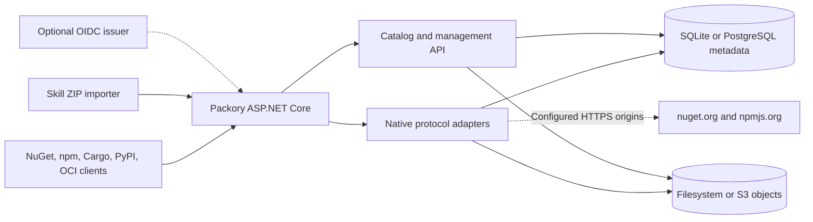

<picture>
  <source media="(prefers-color-scheme: dark)" srcset="docs/branding/banner-dark.svg">
  
</picture>

# Packory

**Brand and UI design:** [Logo + light/dark templates](docs/branding/README.md) (design concepts only).

**Language:** **English** · [Deutsch](README.de.md)

[](https://github.com/Cenn0/Packory/actions/workflows/ci.yml)
[](LICENSE)

**Explore:** [Quick start](#quick-start) · [Capabilities](#implemented-capabilities) · [Architecture](#architecture-overview) · [Docs](docs/README.md) · [Roadmap V3](docs/roadmap.md) · [Support matrix](docs/support-matrix.md) · [Release gates](docs/release-gates.md)

**A self-hosted distribution hub for developer packages and AI agent skills.**


Packory combines native package-registry endpoints, an indexed artifact catalog and a small web dashboard. The current implementation is an **ASP.NET Core / .NET 10 modular monolith**. SQLite and filesystem storage remain the default; PostgreSQL metadata storage and S3-compatible object storage are optional. No broker or Kubernetes cluster is required. Milestone-1 hardening includes single-process artifact locks, reserved private namespaces, startup storage reconciliation, **transactional audit records for successful hosted publishing**, and role-partitioned publish rate limiting.

> **Status: experimental platform, not production-hardened.** The implemented adapters and optional backends have bounded test coverage; protocol, migration and multi-node guarantees remain incomplete. The catalog lists packages already hosted or cached by Packory, not the complete upstream registries.

## Quick start

Requires Docker Compose. For local evaluation:

```bash
git clone https://github.com/Cenn0/Packory.git
cd Packory
export PACKORY_ADMIN_TOKEN="$(openssl rand -hex 32)"
docker compose up -d --build
```

Open **http://localhost:8080/**. The token enables administrative actions; do not commit it or paste it into issues. The example Compose configuration binds to `127.0.0.1:8080` and persists data in the `packory-data` volume.

To run directly with the .NET 10 SDK instead:

```bash
export PACKORY_ADMIN_TOKEN="$(openssl rand -hex 32)"
export PACKORY_PUBLIC_BASE_URL=http://localhost:8080
dotnet run --project src/Packory --urls http://localhost:8080
```

See [operations](docs/operations.md) before enabling network access or choosing a permanent data directory.

## Implemented capabilities

| Area | Implemented scope |
| --- | --- |
| **NuGet V3** | Service index, package/version downloads, read-through caching from nuget.org, registration metadata and basic hosted publishing; experimental private hosted NuGet feeds with separate tokens and immutable SHA-512 |
| **npm** | Upstream metadata and tarball caching, scoped package handling and basic single-version publishing |
| **OCI (experimental)** | Hosted Distribution v2 endpoints for SHA-256 blobs, chunk uploads, manifests, tags and referrers; incomplete client/auth support |
| **Cargo & PyPI (experimental)** | Hosted Cargo alternate registry (sparse index, binary publish), PyPI Simple API (HTML/JSON) and basic distribution upload; not full ecosystem support |
| **Agent skills** | Import, list and download versioned ZIP files containing a simple `SKILL.md` manifest |
| **Dashboard/API** | Searchable catalog of cached/hosted artifacts and liveness/readiness endpoints |
| **Access** | Static read/write/admin tokens and optional OIDC JWT validation with explicit `packory.read`, `packory.write` and `packory.admin` scopes; no browser SSO/BFF |
| **Storage** | SQLite + filesystem by default; optional PostgreSQL metadata and S3-compatible blob backends for fresh single-node installations |

### Use Packory as a registry

NuGet service index: `http://localhost:8080/nuget/v3/index.json`.

```bash
# HTTP is appropriate only for local development.
dotnet nuget add source http://localhost:8080/nuget/v3/index.json \
  --name packory --allow-insecure-connections

# Use the local npm registry for one command.
npm install --registry=http://localhost:8080/npm/ lodash
```

Publish operations require an appropriate token. [API examples](docs/api.md) explain NuGet push, npm publishing and agent-skill ZIP imports without placing credentials in tracked files. The skills importer **validates archives but does not establish that their contents are safe to execute**.

## Architecture overview



NuGet and npm keep their **own native protocols** while sharing the catalog and storage. In-process coordination and hosted-publish auditing are not multi-node or distributed ACID guarantees. See [architecture](docs/architecture.md).

## Limitations and security

- NuGet and npm support useful registry flows, but **not full protocol parity**. Verify your exact client/version/workflow before relying on Packory.
- Search covers locally indexed artifacts. Fresh upstream metadata and uncached downloads may require connectivity.
- Static tokens are not individual user accounts. **OIDC JWT validation is implemented but browser SSO/BFF, per-package permissions, individual actor attribution, a comprehensive/immutable audit trail and high availability are not implemented.** The existing admin-only log records **successful hosted publishes**, not every action or denied attempt.
- Reserved NuGet ID prefixes and npm scopes can prevent configured private namespaces from falling back to public upstreams. This is **not** a comprehensive package-policy or malware-scanning solution. Signature enforcement, cache eviction and automatic license compliance are also absent.
- **Cargo, PyPI and OCI hosted adapters are implemented experimentally.** PostgreSQL and S3 are selectable backends, but automatic SQLite/filesystem migration, distributed metadata/blob transactions and multi-node services are **not** implemented.

Per-role in-process publish throttling complements, but **does not replace, proxy-level rate limits**. Single-process locks do **not** provide multi-node consistency. Startup reconciliation can detect or quarantine selected inconsistent artifacts; it does not replace verified backups. The default Docker port is loopback-only. For any shared deployment, use HTTPS and explicit access controls; keep tokens in a secrets manager, review logging and upstream network access, and back up **the selected metadata database and artifact storage consistently**. Do not execute untrusted skills or packages on the server. See [security and operations](docs/operations.md).

## Build and test

```bash
dotnet restore Packory.slnx
dotnet build Packory.slnx -c Release --no-restore
dotnet test Packory.slnx -c Release --no-build
node --check src/Packory/wwwroot/app.js
# Requires the .NET 10 SDK, npm/Node.js, curl and OpenSSL:
bash scripts/smoke-hosted.sh
bash scripts/smoke-ecosystems.sh
```

[CI](.github/workflows/ci.yml) runs builds, deterministic integration tests and a [native-client hosted smoke test](scripts/smoke-hosted.sh): a real `dotnet nuget push` followed by an isolated `dotnet restore/build`, plus a scoped `npm publish` followed by `npm install` and fresh-cache `npm ci`. Test credentials are generated temporarily and never committed. CI also exercises native Cargo publish/consume, a pip installation with a hosted transitive dependency, and one Docker OCI push/pull scenario using a local scratch image. A [separate live mirror workflow](.github/workflows/smoke-live.yml) checks upstream registry behavior; passing one native hosted scenario does not imply comprehensive protocol support.

## Documentation and contributions

[Documentation index](docs/README.md) · [Cargo & PyPI](docs/cargo-pypi.md) · [OCI](docs/oci.md) · [OIDC / Keycloak](docs/oidc-keycloak.md) · [PostgreSQL](docs/operations.md#postgresql-metadata-backend) · [S3](docs/s3.md) · [Architecture](docs/architecture.md) · [API](docs/api.md) · [Operations](docs/operations.md) · [Roadmap](docs/roadmap.md) · [Contributing](CONTRIBUTING.md) · [Security policy](SECURITY.md)

Licensed under [Apache-2.0](LICENSE). Contributions and public bug reports are welcome; report security vulnerabilities using the private channel described in the security policy.
