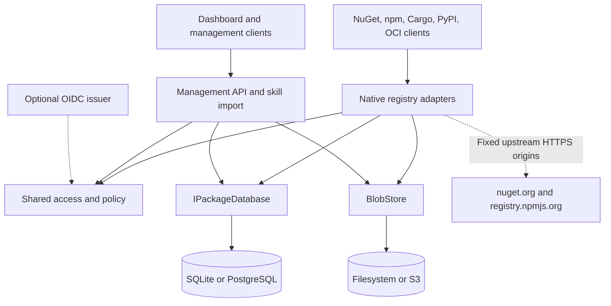

# Packory runtime architecture

Status: **experimental modular monolith; optional PostgreSQL, S3 and OIDC plus hosted Cargo, PyPI and OCI adapters** · October 2026

## Decision

A **single modular ASP.NET Core 10 application** houses protocol adapters, shared artifact persistence, access control, management API and static dashboard. This keeps the first deployable version simple enough to self-host and operate without an external message broker or orchestrator. Each registry protocol has its own URLs and adapter to avoid pretending NuGet and npm share a wire protocol. They share **only** the catalog, blob store and administration interfaces.

## Components and boundaries

Modules:

- `NuGetEndpoints` + `NugetRegistration`: service index, package index, registration metadata, content, SHA512, search and package push; mirrors the upstream registration JSON and rewrites download/registration paths.
- `NpmEndpoints`: packuments, dist-tag/version merging for hosted package versions, tarball cache/validation and publish payloads.
- `SkillEndpoints`: archive validation, manifest metadata, versioned downloads. No archive extraction/execution on disk.
- `IPackageDatabase` implemented by SQLite `Database` and `PostgresDatabase`: shared catalog, registry-specific metadata, OCI references and hosted-publish audit; each provider has its own transactional boundary.
- `BlobStore` (filesystem) and `S3BlobStore` (optional): immutable objects and size-bounded writes. S3 uses conditional writes and local materialization; this is **not** cross-store ACID.
- `ArtifactLocks`: bounded striped per-artifact coordination for uploads and cache cold misses, **single-process only**.
- `ArtifactRecovery`: checks artifact references against the selected store; local unindexed immutable files can be quarantined, but remote S3 orphan collection and distributed reconciliation are not implemented.
- Hosted publication transactions append a limited audit event (credential role, not a user identity); read access is restricted to administrators. A bounded in-process rate limiter guards mutation endpoints.
- `Access`: authorization from static API tokens and optional validated OIDC JWT scopes. Read is anonymous by default; writes require explicit permission; interactive browser SSO is not implemented.
- `wwwroot`: standalone JS/CSS dashboard, no third-party runtime CDN.

## Core invariants

1. **Trust upstream only through configured URLs.** User-supplied package identifiers are validated, never interpreted as URLs. npm tarball redirects are constrained to the configured HTTPS upstream host before requesting them. Review reverse-proxy and DNS-level egress controls before Internet exposure.
2. **Packages are immutable at the artifact key.** A second upload of the same package/version is rejected. Each blob write is a temporary file plus atomic rename. Metadata is recorded only once a file has been written.
3. **Checksums:** upstream NuGet package SHA-512 is checked when the upstream supplies one; npm tarballs are checked against `dist.integrity` or `dist.shasum` when published. These checks verify transport against upstream-declared data, **not provenance or malware safety**.
4. **No unbounded uploads:** request/body limits, metadata limits, and compressed/uncompressed skill ZIP limits. NuGet archives are inspected only for a single root `.nuspec` with DTD processing disabled.
5. **Public base URL is configured, not inferred** from untrusted `Host` or forwarded headers; generated package URL rewriting stays pinned to this origin.
6. **No personally identifiable data or secrets in source, example config, or CI logs.** Configure secrets via runtime environment/secret manager; never check in `.env` or `.npmrc`.

## Persistence and consistency

SQLite remains the default **single-instance** profile; PostgreSQL metadata and S3 object storage are optional and tested separately. Neither profile guarantees multi-node publishing. Database transactions and object-store writes are **not** a shared distributed ACID transaction. On unexpected termination, an artifact may exist without a catalog entry. Before traffic starts, recovery moves unindexed local immutable files to `data/recovery/orphaned/` and logs the count without deleting them. PostgreSQL/S3 publication journals and opt-in reviewed remote quarantine provide a separate recovery path; they do not constitute a real-provider restore guarantee. Missing hosted blobs degrade `/health/ready` (HTTP 503). This is recovery of **visibility**, not a cross-store ACID transaction or automated restoration of missing bytes. Consistent metadata-database snapshots plus artifact-store backups are required for restoration. Avoid concurrent replicas on the same directory; WAL is not multi-host coordination.

`origin` in the unified catalog is `hosted` or `mirror`. Upstream packages enter the catalog after artifact download, not merely after metadata lookup. Hosted npm versions and skills enter immediately after successful upload. Search is not federated across remote registries in MVP.

## Constraints and next decisions

PostgreSQL and S3 are selectable providers. A PostgreSQL **single-writer advisory lease**, durable publication intent journal and explicit S3 orphan quarantine are implemented and emulator-tested, but this does **not** establish partition fencing, a coordinated DB/object-store transaction, migration tooling or a verified real-provider restore. Private namespace reservations suppress public upstream metadata and file fallback. Each new ecosystem needs its own client-contract tests, mirror retention semantics, credential strategy, and security review. A distributed service topology has no demonstrated benefit at this scale; defer it until performance/SLO data supports the cost.

See [Roadmap](roadmap.md) for implementation sequence and [Operations](operations.md) for deployment risk controls.

## Experimental global Maven adapter (V4 E2 partial)

Maven release asset paths, POM identity validation and file-level SHA-256 ledger use V6 schema, shared blob providers and recovery intents. The Maven-compatible GET endpoint supports narrowly scoped native artifact consumption, not standard Maven deploy, private feeds or upstream proxy. See [Maven](maven.md).

## Experimental global Raw adapter (V4)

An immutable Raw transport maintains publication-time SHA-256 metadata in schema V5, durable intents and integrity/recovery references. This is a global namespace, not a feed-isolated native registry. See [Raw API](raw-registry.md).

## Experimental native registry adapters (Cargo and PyPI)

The hosted Cargo alternate registry uses its own native sparse index and Cargo publish wire format; PyPI serves PEP 503/691 HTML/JSON and accepts legacy multipart uploads. Both share the selected metadata and blob providers, static-token/OIDC authorization, artifact locks and publish audit with the existing modules. Crate and distribution files are immutable per key. See [Cargo and PyPI](cargo-pypi.md) for missing protocol features, test coverage and security limits.

## Hosted OCI adapter (experimental)

OCI distribution routes use their own `/v2/` namespace. Digest-indexed blobs and immutable manifests are stored in the shared artifact file store; repository/blob associations, digest-tag pointers and referrers are recorded in the selected metadata database. Uploads have bounded short-lived disk staging sessions, and manifest references require existing repository-scoped content. The adapter does not claim full OCI Distribution Spec conformance or Docker Bearer-token support. See [OCI](oci.md).

## V3 evolution (not implemented)

The current global catalog does **not** yet provide independent Feed/Namespace/Policy entities, CAS reference counting, or a browser BFF. Add them only through versioned migrations and separately authorized APIs. See [ADR-001](adr/0001-v3-platform-boundaries.md), [support matrix](support-matrix.md) and [release gates](release-gates.md). Restricted S3/PostgreSQL reader replicas exist, while NuGet/npm mirror GETs remain disabled on readers; no active-active writing.
