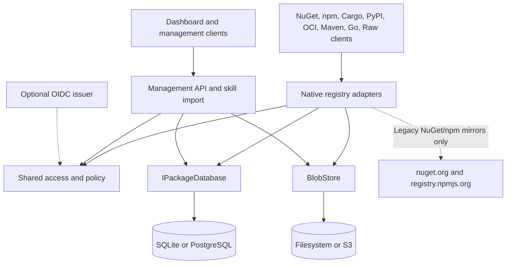

# Packory runtime architecture

Status: **modular monolith with eight private hosted package adapters; optional PostgreSQL, S3 and OIDC** · 21 October 2026. The E0 hosted package foundation is accepted; its exact implementation and CI evidence are recorded in [E0 acceptance](e0-acceptance.md).

## Decision

A **single modular ASP.NET Core 10 application** houses protocol adapters, shared artifact persistence, access control, management API and static dashboard. This keeps the first deployable version simple enough to self-host and operate without an external message broker or orchestrator. Each registry protocol has its own URLs and adapter to avoid pretending NuGet and npm share a wire protocol. They share **only** the catalog, blob store and administration interfaces.

Global routes coexist with explicitly activated private hosted NuGet, npm, Cargo, PyPI, OCI, Maven, Go and Raw feeds. Private routing, exact grants and storage identities are independent of the global catalog. The hosted origin policy never falls back to global or upstream artifacts; proxy/group feeds and private Skill/MCP delivery remain separate milestones. See [feed operations](feeds.md) for protocol-specific routes and limits.

## Components and boundaries

Modules:

- `NuGetEndpoints` + `NugetRegistration`: service index, package index, registration metadata, content, SHA512, search and package push; mirrors the upstream registration JSON and rewrites download/registration paths.
- `NpmEndpoints`: packuments, dist-tag/version merging for hosted package versions, tarball cache/validation and publish payloads.
- `FeedEndpoints` / `FeedDefinition`: administrator-only inventory and disabled draft lifecycle; explicit activation for the eight implemented private hosted package kinds. Previously activated IDs remain reserved, including empty deactivated feeds, so old managed/OIDC grants cannot attach to a new identity. Creation also checks historical activation, managed-grant and publication-intent references when a feed row is absent. Legacy descriptors do not grant access, and proxy/Skill drafts stay disabled.
- `FeedNugetEndpoints`, `FeedNpmEndpoints`, `FeedCargoEndpoints`, `FeedPyPiEndpoints`, `FeedOciEndpoints`, `FeedMavenEndpoints`, `FeedGoEndpoints` and `FeedRawEndpoints`: native private routes that check the exact feed permission and active kind before querying scoped metadata. Private OCI occupies `/v2/feeds/{id}/{repository}/`; the global OCI repository prefix `feeds/` is reserved.
- `FeedAssetEntry` / `FeedPackageStore`: native coordinate validation, feed-qualified object identity and immutable metadata/payload bundles for npm/Cargo/PyPI. `FeedGoBundle` binds the Go triplet to the feed. NuGet retains its dedicated immutable checksum ledger; OCI uses digest assets with separate mutable tag references.
- `SkillEndpoints`: archive validation, manifest metadata, versioned downloads. No archive extraction/execution on disk.
- `PackoryMcpServer` and `McpArtifactCatalog`: official SDK Streamable HTTP adapter, shared global artifact capabilities and keyset catalog queries. Skill snapshots bind approved ZIP bytes, canonical resource paths and file digests; private-feed rows are excluded from global discovery.
- `McpRegistryStore` / `McpRegistryEndpoints`: immutable operator-reviewed remote descriptors, v0.1 read envelopes and Packory management routes. Descriptors are inert; registry reads cannot contact their endpoints or forward credentials.
- `SkillQualityAssessment`: deterministic read-only documentation checks over the same verified Skill snapshot, exposed through REST, MCP and the dashboard. Security approval, integrity, static quality and external verifier attestations retain distinct meanings.
- `IPackageDatabase` implemented by SQLite `Database` and `PostgresDatabase`: shared catalog, registry-specific metadata, OCI references and hosted-publish audit; each provider has its own transactional boundary.
- `BlobStore` (filesystem) and `S3BlobStore` (optional): immutable objects and size-bounded writes. S3 uses conditional writes and local materialization; this is **not** cross-store ACID.
- `ArtifactLocks`: bounded striped per-artifact coordination for uploads and cache cold misses, **single-process only**.
- `ArtifactRecovery`: reconciles publication intents and ledger references, including private feed assets; eligible unindexed local objects can be quarantined. Remote S3 quarantine is a separate explicit reviewed operation, without distributed reconciliation or automatic repair of missing committed bytes.
- Hosted publication transactions append a limited audit event (credential role, not a user identity); read access is restricted to administrators. A bounded in-process rate limiter guards mutation endpoints.
- `Access`: static/managed credentials and optional validated OIDC JWT scopes. Global reads follow anonymous-read configuration; private reads always require an exact feed grant. Feed-scoped credentials do not grant global catalog/MCP access. Interactive browser SSO is not implemented.
- `wwwroot`: standalone JS/CSS dashboard, no third-party runtime CDN.

## Core invariants

1. **Bound origins to the adapter's policy.** Legacy mirrors use administrator-configured upstream URLs and validated redirects. Private hosted adapters have no upstream/global/cross-feed fallback. User-supplied package coordinates never become arbitrary fetch URLs.
2. **Bytes are immutable at their artifact key.** Conflicting package/file revisions are rejected. OCI may acknowledge an already verified identical digest and may move a tag to another immutable manifest; it cannot replace digest bytes. Filesystem writes use atomic rename and S3 uses conditional writes. Serving metadata is committed after the object exists.
3. **Checksums:** upstream NuGet package SHA-512 is checked when the upstream supplies one; npm tarballs are checked against `dist.integrity` or `dist.shasum` when published. These checks verify transport against upstream-declared data, **not provenance or malware safety**.
4. **No unbounded uploads:** request/body limits, metadata limits, and compressed/uncompressed skill ZIP limits. NuGet archives are inspected only for a single root `.nuspec` with DTD processing disabled.
5. **Public base URL is configured, not inferred** from untrusted `Host` or forwarded headers; generated package URL rewriting stays pinned to this origin.
6. **No personally identifiable data or secrets in source, example config, or CI logs.** Configure secrets via runtime environment/secret manager; never check in `.env` or `.npmrc`.

## Persistence and consistency

SQLite remains the default **single-instance** profile; PostgreSQL metadata and S3 object storage are optional and tested separately. Neither profile guarantees multi-node publishing. Database transactions and object-store writes are **not** a shared distributed ACID transaction. On unexpected termination, an artifact may exist without a catalog entry. Before traffic starts, recovery moves unindexed local immutable files to `data/recovery/orphaned/` and logs the count without deleting them. PostgreSQL/S3 publication journals and opt-in reviewed remote quarantine provide a separate recovery path; they do not constitute a real-provider restore guarantee. Missing hosted blobs degrade `/health/ready` (HTTP 503). This is recovery of **visibility**, not a cross-store ACID transaction or automated restoration of missing bytes. Consistent metadata-database snapshots plus artifact-store backups are required for restoration. Avoid concurrent replicas on the same directory; WAL is not multi-host coordination.

`origin` in the unified catalog is `hosted` or `mirror`. Upstream packages enter the catalog after artifact download, not merely after metadata lookup. Hosted npm versions enter after successful upload. Skills are staged and become discoverable only when the active release policy allows them; MCP artifact pagination applies that approval predicate before the database page limit. Search is not federated across remote registries.

### Private artifact visibility and schema V11

The current schema is **V11**. Its additive `maven_metadata` table stores exact publisher XML and digests under `(scope,path)` with atomic metadata/audit updates. Existing private ledgers remain unchanged. `feed_assets` stores immutable native identities as `(feed_id, kind, path)`, along with name/version, media type, SHA-256 and length. It covers Raw, Maven, Go, npm, Cargo, PyPI and OCI. `feed_nuget_versions` retains the existing NuGet SHA-512 identity. `feed_oci_tags` stores feed/repository/tag pointers separately from immutable manifest records. The V10 migration preserves prior private rows and keys; it does not migrate global coordinates into feeds.

For npm/Cargo/PyPI, one bundle contains a bounded metadata envelope and the original package payload. The envelope binds feed, kind, canonical path, native name/version, payload length and SHA-256. A read first verifies the ledger's digest and length for the complete object, then the envelope identity and payload checksum, and finally the adapter's protocol metadata. Thus a valid-looking manifest cannot make substituted package bytes visible. Go applies the same principle to one immutable `.info`/`.mod`/`.zip` triplet. Maven and Raw retain their file identities; OCI keeps feed/repository-scoped digest objects.

Publication order is intent → immutable object → transactional ledger/audit → completed intent. Faults between those boundaries preserve evidence, without inventing serving metadata. Recovery, integrity enumeration and offline snapshots include private asset and OCI tag references. The shared helper's tests cover store failures and interrupted metadata commits; actual PostgreSQL/S3 and restore results remain separately reported in [E0 acceptance](e0-acceptance.md). A single-process lock and a durable journal do not turn database/object storage into a distributed transaction.

MCP Registry publisher verification, source synchronization and durable multi-profile assessments are separate domain additions. A future functional evaluator or MCP gateway requires an isolated execution service with its own credentials, authorization, network/resource limits and lifecycle. Neither belongs inside the registry's request process. See the [MCP delivery roadmap](mcp-roadmap.md) for dependencies and concrete acceptance criteria.

## Constraints and next decisions

PostgreSQL and S3 are selectable providers. A PostgreSQL **single-writer advisory lease**, durable publication intent journal and explicit S3 orphan quarantine are implemented and emulator-tested, but this does **not** establish partition fencing, a coordinated DB/object-store transaction, migration tooling or a verified real-provider restore. Private namespace reservations suppress public upstream metadata and file fallback. Each new ecosystem needs its own client-contract tests, mirror retention semantics, credential strategy, and security review. A distributed service topology has no demonstrated benefit at this scale; defer it until performance/SLO data supports the cost.

See [Roadmap](roadmap.md) for implementation sequence and [Operations](operations.md) for deployment risk controls.

## Experimental global Maven adapter (V4 E2 partial)

The global Maven release adapter originated with schema V6. Private Maven uses the feed asset ledger and independent `/feeds/{id}/maven/` routes with POM identity checks, generated feed-local metadata and verified file checksums. Both profiles now support bounded native Maven release and timestamped SNAPSHOT deployment, exact mutable repository metadata, and ordinary Maven/Gradle transitive dependency consumption. Files remain immutable; metadata updates validate same-scope references and use compare-and-swap. Upstream proxy, atomic publication of a whole multi-file release and wider Gradle variant qualification remain separate E2 work. See [global Maven](maven.md) and [private Maven](feeds.md#maven).

## Experimental global Raw adapter (V4)

The original global Raw transport maintains immutable SHA-256 metadata and durable intents. Private Raw adds an independently authorized `/feeds/{id}/raw/` namespace using the feed ledger. Both distribute generic HTTP bytes and metadata rather than a native package-manager format. See [Raw API](raw-registry.md) and [private Raw](feeds.md#raw--generic).

## Experimental native registry adapters (Cargo and PyPI)

Global and private Cargo use the native sparse index/publish wire format; PyPI serves Simple HTML/JSON and accepts Twine-compatible multipart uploads. Private adapters bundle index/core metadata with unchanged archive bytes and generate URLs only for the authorized feed. Private Cargo has no yank API; private PyPI uses a bounded canonical PEP 440 version profile without epochs and has no direct-URL dependency or extra-index fallback. Native wheel tests do not qualify arbitrary source builds. See [Cargo and PyPI](cargo-pypi.md) and [private profiles](feeds.md).

## Hosted OCI adapter (experimental)

OCI retains the native `/v2/` namespace, with private repositories below `/v2/feeds/{id}/`. Private blobs, manifest references, mutable tags, referrers and durable upload sessions are bound to both feed and repository. Content descriptors require same-repository verified assets; the accepted subject profile permits a missing subject. Alternate descriptor URLs are rejected, and inline data must match its declared SHA-256 and size without replacing a ledger reference. A cross-namespace mount request starts an upload instead of granting access to another namespace's blob. The `/v2/` handshake accepts authenticated feed credentials without granting global repository reads. Pinned Helm 3.22.0 private push/pull/template and restart evidence does not establish private Docker/ORAS, multi-node upload handoff or full OCI conformance. See [OCI](oci.md) and [private OCI](feeds.md#oci-and-helm).

## Remaining V3 evolution

Feed metadata, activation and private hosted routing are implemented. General proxy/group semantics, complete namespace/policy/retention/quotas, declarative feed import/export, CAS reference counting and browser BFF remain later MS2/MS4 work. Private Skill distribution and feed-aware MCP discovery remain MS5/MCP-P5. See [ADR-001](adr/0001-v3-platform-boundaries.md), [support matrix](support-matrix.md), [E0 acceptance](e0-acceptance.md) and [release gates](release-gates.md). Restricted S3/PostgreSQL reader replicas exist, while NuGet/npm mirror GETs remain disabled on readers; active-active writing is not supported.
