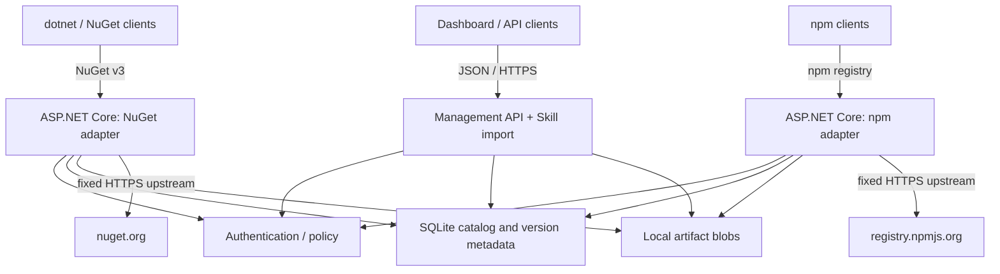

# Architecture decision record: Packory MVP

Status: **MVP plus initial milestone-1 hardening** · October 2026

## Decision

A **single modular ASP.NET Core 10 application** houses protocol adapters, shared artifact persistence, access control, management API and static dashboard. This keeps the first deployable version simple enough to self-host and operate without an external message broker or orchestrator. Each registry protocol has its own URLs and adapter to avoid pretending NuGet and npm share a wire protocol. They share **only** the catalog, blob store and administration interfaces.

## Components and boundaries

Modules:

- `NuGetEndpoints` + `NugetRegistration`: service index, package index, registration metadata, content, SHA512, search and package push; mirrors the upstream registration JSON and rewrites download/registration paths.
- `NpmEndpoints`: packuments, dist-tag/version merging for hosted package versions, tarball cache/validation and publish payloads.
- `SkillEndpoints`: archive validation, manifest metadata, versioned downloads. No archive extraction/execution on disk.
- `Database`: SQLite catalog, npm hosted versions/dist-tags, skills. WAL mode, unique keys and scoped queries.
- `BlobStore`: writes to an unpredictable temporary file, enforces size limits and renames into place (create-only for immutable packages, replace for upstream metadata).
- `ArtifactLocks`: bounded striped per-artifact coordination for uploads and cache cold misses, **single-process only**.
- `ArtifactRecovery`: scans immutable blob keys against SQLite references before serving traffic; unindexed files are moved to a non-destructive local recovery directory.
- `Access`: access scopes from static API tokens. Read is anonymous by default; writes require a token.
- `wwwroot`: standalone JS/CSS dashboard, no third-party runtime CDN.

## Core invariants

1. **Trust upstream only through configured URLs.** User-supplied package identifiers are validated, never interpreted as URLs. npm tarball redirects are constrained to the configured HTTPS upstream host before requesting them. Review reverse-proxy and DNS-level egress controls before Internet exposure.
2. **Packages are immutable at the artifact key.** A second upload of the same package/version is rejected. Each blob write is a temporary file plus atomic rename. Metadata is recorded only once a file has been written.
3. **Checksums:** upstream NuGet package SHA-512 is checked when the upstream supplies one; npm tarballs are checked against `dist.integrity` or `dist.shasum` when published. These checks verify transport against upstream-declared data, **not provenance or malware safety**.
4. **No unbounded uploads:** request/body limits, metadata limits, and compressed/uncompressed skill ZIP limits. NuGet archives are inspected only for a single root `.nuspec` with DTD processing disabled.
5. **Public base URL is configured, not inferred** from untrusted `Host` or forwarded headers; generated package URL rewriting stays pinned to this origin.
6. **No personally identifiable data or secrets in source, example config, or CI logs.** Configure secrets via runtime environment/secret manager; never check in `.env` or `.npmrc`.

## Persistence and consistency

SQLite is suitable for a **single writer/deployment** and basic searches at MVP scale. Files and SQLite are not a distributed ACID transaction. On unexpected termination, an artifact may exist without a catalog entry. Before traffic starts, recovery moves unindexed immutable files to `data/recovery/orphaned/` and logs the count; it does not delete them. Missing hosted blobs degrade `/health/ready` (HTTP 503). This is recovery of **visibility**, not a cross-store ACID transaction or automated restoration of missing bytes. Database snapshots plus blob backups are required for restoration. Avoid concurrent replicas on the same directory; WAL is not multi-host coordination.

`origin` in the unified catalog is `hosted` or `mirror`. Upstream packages enter the catalog after artifact download, not merely after metadata lookup. Hosted npm versions and skills enter immediately after successful upload. Search is not federated across remote registries in MVP.

## Constraints and next decisions

Moving to PostgreSQL/object storage should be behind repository interfaces, with a **single-writer lease or transactional outbox** for metadata/blob durability. Private namespace reservations suppress public upstream metadata and file fallback. Each new ecosystem needs its own client-contract tests, mirror retention semantics, credential strategy, and security review. A distributed service topology has no demonstrated benefit at this scale; defer it until performance/SLO data supports the cost.

See [Roadmap](roadmap.md) for implementation sequence and [Operations](operations.md) for deployment risk controls.
