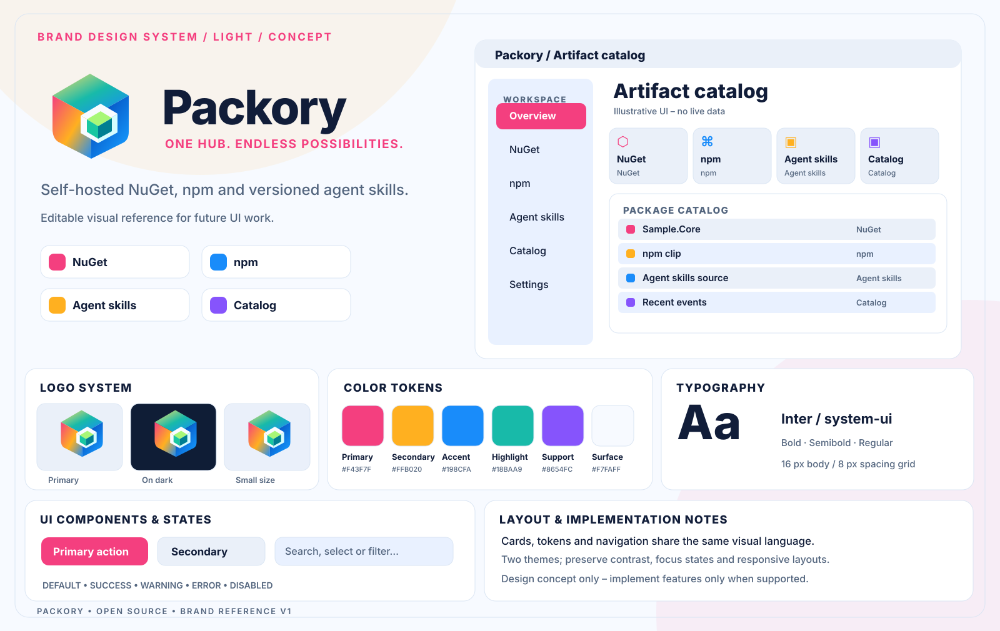
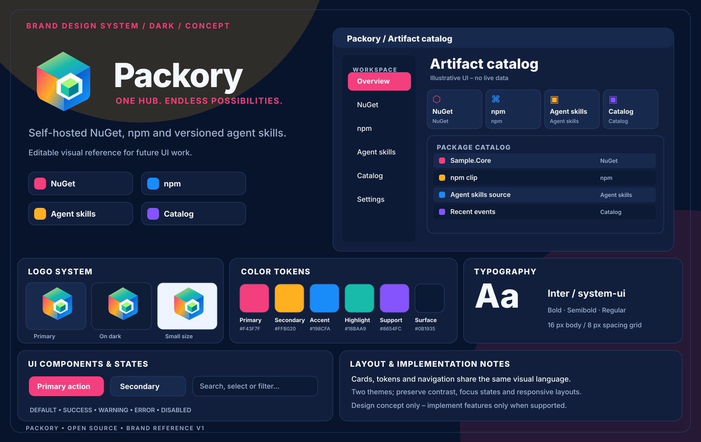

# Packory brand identity and UI concepts

## Brand banners

The logo and **ONE HUB. ENDLESS POSSIBILITIES.** tagline appear together in the README banner. It switches between self-contained [light](banner-light.svg) and [dark](banner-dark.svg) SVG variants using `<picture>`, and contains no remote assets. The established [compact P/package mark](logo.svg) remains the application's favicon and header symbol.

**Design reference, not a product screenshot or an implementation claim.**

The self-contained SVG assets are versioned for later UI design. [Brand logo](logo.svg) and both full-sized concept boards are editable without external scripts or fonts.

| Token | HEX |
| --- | --- |
| Primary | `#F43F7F` |
| Secondary | `#FFB020` |
| Accent | `#198CFA` |
| Highlight | `#18BAA9` |
| Support | `#8654FC` |
| Light surface | `#F7FAFF` |
| Dark surface | `#0C1A35` |

Use Inter with system font fallbacks and an 8 px spacing grid. Implement semantic tokens, focus indicators, responsive layouts, accessible contrast and localization. The illustrated dashboard is aspirational; consult the project's README, roadmap and security documentation for actual capabilities. Never put personal contact information, production data or credentials in public design assets.

**No trademark clearance is claimed.** Visually distinctive designs still need separate professional trademark research before exclusive brand claims.
