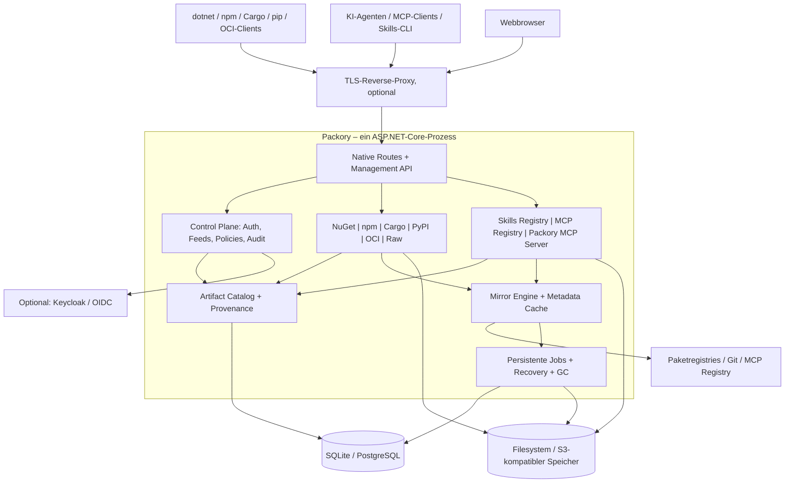
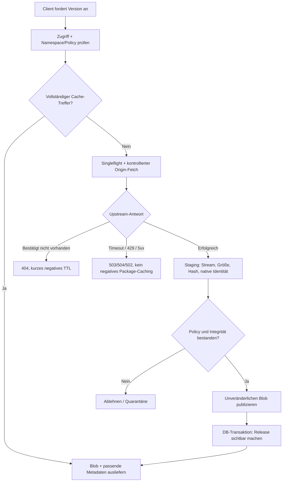
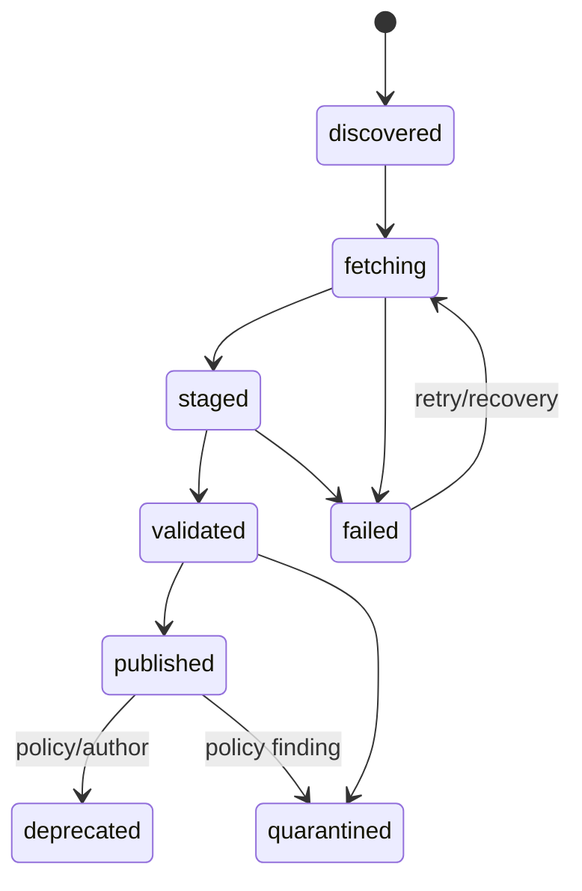

# Packory – Zielarchitektur

**Stand:** 16. Oktober 2026  
**Status:** Vorgeschlagene Architektur, noch keine implementierte Packory-Anwendung  
**Leitbild:** *A lightweight, self-hosted distribution hub for software packages and AI artifacts.*

> Architektur- und API-Beispiele in diesem Dokument sind Entwürfe. `example.invalid` ist ausdrücklich keine nutzbare Domain. „Offiziell unterstützt“ bedeutet bei Packory erst: durch veröffentlichte Client-/Protokolltests belegt.

## 1. Produktdefinition und Architekturziele

Packory bündelt Auffindbarkeit, Hosting, Mirror, Cache, Zugriffskontrolle, Provenienz und Distribution von Artefakten in einer zentralen Installation. Das umfasst klassische Pakete (NuGet, npm, Cargo, PyPI), generische Dateien, Agent Skills, MCP-Server-Metadaten und perspektivisch OCI-Artefakte, Container, Modelle, Workflows und weitere Formate.

**Nichtziele:** Git-Hosting, CI/CD-Engine, beliebige Build-Ausführung, eigener KI-Inferenzdienst, standardmäßig ausgeführte Agent-Skills, integrierter MCP-Gateway im MVP, proprietäre Übersetzung aller Formate in ein einziges Clientprotokoll. Eine vollständige Replikation des gesamten öffentlichen npm-/NuGet-/Cargo-Ökosystems ist ebenfalls kein MVP-Ziel.

**Architekturprinzipien:**
1. Ein *Artifact Core* für gemeinsame Metadaten, Datei-Referenzen, Zugriffskontrolle und Herkunft.
2. Getrennte *native Protokolladapter* statt eines künstlich universellen Registry-Protokolls.
3. *Metadatenkatalog ≠ gespeicherter Binärinhalt*: ein remote erreichbarer MCP-Server besitzt möglicherweise keinen Blob in Packory.
4. Ein modularer Monolith als Standard; definierte Ports ermöglichen spätere Prozessauslagerung ohne vorzeitige Microservices.
5. Inhalte unveränderlich adressieren, mutable Tags/Indizes ausdrücklich getrennt verwalten.
6. Sichere Voreinstellungen: kein anonymes Publizieren, keine Ausführung importierter Inhalte, minimale Berechtigungen, kontrollierte Upstream-Zugriffe.
7. Eine Funktion gilt erst nach reproduzierbaren echten Clienttests und Fehlerszenarien als unterstützt.

## 2. Systemkontext und Prozesse



*Die Pfeile zeigen logische Abhängigkeiten, keine für jeden Request notwendigen Netzwerkaufrufe. Die Control Plane liegt nicht auf dem Binär-Streaming-Datenpfad; Autorisierungsentscheidungen erfolgen über gemeinsam genutzte interne Dienste.*

### 2.1 Betriebsprofile

| Profil | Prozessmodell | Datenhaltung | Anspruch |
|---|---|---|---|
| `standalone` | 1 Packory-Prozess | SQLite + lokales Dateisystem | **Primärpfad**: ein Container, persistentes Volume, kein Redis/Keycloak erforderlich |
| `server` | 1 Packory-Prozess, optionale separate Worker | PostgreSQL + S3-kompatibel | Längere Aufbewahrung, große Blobs, dedizierte Backups; separat zu qualifizieren |
| `distributed` | mehrere API-/Adapter-/Worker-Instanzen | PostgreSQL + S3 + verteilte Koordination | **Später**; keine HA-Aussage ohne Lock-/Fencing- und Recovery-Nachweis |

Für `standalone` ist **ein einziger Schreibprozess** verbindlich. SQLite auf gemeinsamem Netzdateisystem und zwei unabhängige Hosts mit geteiltem Dateispeicher sind nicht automatisch unterstützte Betriebsarten.

## 3. Bounded Contexts und Modulgrenzen

| Modul | Verantwortung | Darf nicht besitzen |
|---|---|---|
| `Packory.Host` | ASP.NET Core, Middleware, Routing, DI, Health, Konfiguration | native Paketsemantik |
| `Packory.Core` | Artefakt-, Feed- und Provenienztypen, Fehlerverträge | Framework- und Storage-Implementierungen |
| `Packory.Catalog` | Indizierung, Suche, Metadatenmodell, Versionsreferenzen | nativen Wire-Protocol-Serializer |
| `Packory.Feeds` | Hosted-/Proxy-Feeds, Upstreams, Namespace-/Conflict-Policy | direkten Blob-Dateizugriff |
| `Packory.Identity` | lokale Identitäten, OIDC-Integration, Sessions, Service-Tokens, RBAC | Paketparser |
| `Packory.Storage` | Staging, Streaming, SHA-256-CAS, Leseschnittstelle, GC | Zugriff auf ungeprüfte Origins |
| `Packory.Mirror` | Upstream-Clients, TTLs, Singleflight, Integrität, Negative Cache | Benutzerinterface |
| `Packory.Jobs` | DB-Outbox, Retry, Imports, Reconciliation, Audit-Events | unbeschränkte Skriptausführung |
| `Packory.Registry.*` | native Protokoll-Endpunkte und Validierung | eigenständige Benutzer-/Speicherarchitektur |
| `Packory.AI.Skills` | Skill-Manifest, Git-Import, Bundle-Export, Freigabe | Ausführen von Skills |
| `Packory.AI.McpRegistry` | `server.json`, Discovery, Registry-Synchronisierung | Ausführen/Proxyen eines MCP-Servers |
| `Packory.AI.McpServer` | kontrollierter Zugriff auf Packory per MCP | beliebige Tool-Ausführung ohne Autorisierung |
| `Packory.Web` | React/TypeScript-Dashboard | direkte DB-Zugriffe, Secrets im Browser |

**Abhängigkeitsrichtung:** Adapter → Ports in Core/Storage/Catalog/Mirror; Infrastruktur implementiert Ports. Die Control Plane hängt nicht von konkreten NuGet- oder npm-Klassen ab. Keine dynamisch hochladbaren .NET-Plugins im privilegierten Packory-Prozess. Neue Adapter zunächst als source-reviewed, build-time registrierte Module.

### 3.1 Entwurf eines Adaptervertrags (kein bestehender Code)

```csharp
public interface IDistributionProtocolModule
{
    string ProtocolId { get; }
    void MapEndpoints(IEndpointRouteBuilder routes);
    NormalizedIdentity Normalize(NativeIdentity identity);
    ValueTask<ArtifactValidation> ValidateAsync(
        ArtifactInput input, CancellationToken cancellationToken);
}
```

Dieser Vertrag abstrahiert nur Lebenszyklus und gemeinsame Operationen. Protokoll-HTTP-Semantik, Versionsvergleiche, `yanked`, `dist-tags`, Suchformate, OCI-Manifeste etc. bleiben in den jeweiligen Adaptern. Stabile Ports (`IBlobStore`, `ICatalogRepository`, `IAuthorizationService`, `IOriginFetcher`, `IJobQueue`) sind wichtiger als eine übergroße gemeinsame Paket-Schnittstelle.

## 4. Universal Artifact Model

Die beiden Dimensionen **Artefaktart** und **Distributionsprotokoll** sind unabhängig:

- **Artefaktart**: `software-package`, `container`, `agent-skill`, `mcp-server`, `ai-model`, `prompt-bundle`, `raw-file`, später Erweiterungen.
- **Distributionsweg**: `nuget`, `npm`, `cargo`, `pypi`, `oci`, `packory-raw`, `packory-skills`, `mcp-registry`, `git-reference`.
- Beispiel: Ein MCP-Server ist ein Katalogeintrag, dessen Distribution ein npm-Paket **oder** ein OCI-Image **oder** ein Remote-HTTP-Endpunkt sein kann.
- Beispiel: Ein Skill kann per Git-Commit referenziert und zugleich als unveränderliches ZIP-Bundle gespeichert werden.
- Beispiel: Ein KI-Modell kann ein Manifest mit mehreren großen Dateien sein; dies ist *nicht* mit einem NuGet-Paket gleichzusetzen.

### 4.1 Domänenmodell

```mermaid
 erDiagram
    REPOSITORY ||--o{ CATALOG_ITEM : groups
    REPOSITORY ||--o{ UPSTREAM : configures
    CATALOG_ITEM ||--o{ REVISION : versions
    REVISION ||--o{ DISTRIBUTION : provides
    REVISION ||--o{ ASSET : includes
    BLOB ||--o{ ASSET : backs
    REVISION ||--o{ ORIGIN_RECORD : documents
    REPOSITORY ||--o{ ACCESS_GRANT : controls
    REPOSITORY ||--o{ POLICY : enforces
    REPOSITORY ||--o{ CACHE_ENTRY : contains
    PRINCIPAL ||--o{ ACCESS_GRANT : receives
    JOB }o--|| REPOSITORY : operates_on

    REPOSITORY {
      uuid id
      string protocol
      string mode
      string slug
      string visibility
    }
    CATALOG_ITEM {
      uuid id
      string kind
      string native_name
      string canonical_key
    }
    REVISION {
      uuid id
      string native_version
      string immutable_digest
      string state
    }
    DISTRIBUTION {
      uuid id
      string kind
      string protocol
      string locator
    }
    ASSET {
      uuid id
      string filename
      string blob_sha256
    }
    BLOB {
      string sha256
      long size_bytes
      string storage_key
    }
```



**Primärinvarianten:**
- `repository` bezeichnet genau ein natives Client-Protokoll; `hosted`, `proxy`, `virtual` werden getrennt behandelt. `virtual` (Group) erfordert pro Protokoll eine geprüfte Merge- und Konfliktsemantik.
- Katalogeinträge haben eine typ- und protokollspezifische Normalisierung, keine universelle Lowercase-Regel und keine universelle SemVer-Sortierung.
- Eine Revision darf null Blobs besitzen (remote MCP-Server) oder mehrere Assets (Wheels/Modelldateien/OCI-Manifest-Referenzen).
- `origin_record` speichert Quelle, Zeitpunkt, native Prüfsumme, tatsächlich empfangenen Digest, Quelle/Authentizitätsnachweise und gegebenenfalls Build-Attestation.
- Ein öffentlich sichtbarer Release verweist nur auf vollständig überprüfbare Blobs oder explizit als *remote* gekennzeichnete Referenzen.
- `distribution.locator` ist **kein** generischer Downloadproxy und wird niemals ungeprüft dereferenziert.
- Eine deduplizierte CAS-Datei ist ausschließlich über autorisierte Referenzen abrufbar, niemals durch frei erratene interne Digest-Pfade.

### 4.2 Physische Datenspeicherung

```text
/data/
  database/packory.db
  blobs/sha256/ab/cd/<sha256>
  staging/<random-identifier>.part
  maintenance/
```

- DB: relational, Migrationen pro Provider (SQLite / PostgreSQL) testen.
- Dateien: Streaming, feste Maximalgrößen je Artefaktklasse, Grenzen für Archive und Metadatendokumente.
- CAS: SHA-256 über die **unveränderten Originalbytes**, nativen Paket-Hash zusätzlich prüfen. Hashgleichheit alleine beweist keine vertrauenswürdige Herkunft.
- Storage-Adapter: `PutStagedAsync`, `CommitImmutableAsync`, `OpenReadAsync`, `ExistsAndVerifyAsync`, `EnumerateOrphansAsync`.
- S3-/Object-Store-ETags nicht als SHA-256 interpretieren. Multipart-Upload, Abbrüche und Read-after-write je Provider qualifizieren.

## 5. Feed-Typen, Client-Routing und API-Konventionen

### 5.1 Feeds

- `hosted`: private/öffentliche Veröffentlichung direkt in Packory; stabile Repository- und Versionsidentität.
- `proxy`: konfigurierter Origin mit Read-through, Metadaten-Cache und Herkunftsnachweis.
- `virtual` / `group` (**später**): Zusammenführung kompatibler Quellen *innerhalb desselben Protokolls*, nur mit expliziter Konflikt- und Prioritätsrichtlinie.

Eine private Namespace-Reservation (`@internal/*`, eigene NuGet-ID-Präfixe usw.) unterbindet automatisch öffentlichen Fallback und damit typische Dependency-Confusion-Szenarien. Keine unbemerkte Ersetzung lokal publizierter Artefakte durch Upstream-Dateien.

### 5.2 Routen (nur Entwurf)

| API | Beispiel | Zweck |
|---|---|---|
| UI | `https://packages.example.invalid/` | Dashboard |
| Management | `/api/v1/repositories` | Repository-Verwaltung |
| NuGet | `/r/nuget/team/v3/index.json` | NuGet V3-Service-Index |
| npm | `/r/npm/team/` | npm-Package- und Tarball-Endpunkte |
| Cargo | `sparse+https://packages.example.invalid/r/cargo/crates/index/` | Cargo Sparse Index (Client-Konfiguration) |
| PyPI | `/r/pypi/team/simple/` | Python Simple Repository API |
| Raw | `/r/raw/team/{path}` | Generische Dateien |
| Skill REST | `/api/v1/skills` | Eigene Skills-Management-API |
| MCP Registry | `/v0.1/servers` | Generische MCP-Registry-API (Version beachten) |
| Packory MCP | `/mcp` | Packory als Remote MCP-Server, später |
| OCI | `https://oci.example.invalid/v2/` | Später eigener Virtual Host mit OCI Distribution API |

Nur Routen, die tatsächlich implementiert und kompatibilitätsgeprüft sind, werden aktiv beworben. Insbesondere muss NuGet sämtliche im Index angebotenen Ressourcen korrekt bedienen. Forwards und umgeschriebene Download-URLs dürfen nicht versehentlich am konfigurierten Host vorbeigehen.

### 5.3 Verwaltungs-API (Entwurf)

```http
GET    /api/v1/repositories
POST   /api/v1/repositories
GET    /api/v1/repositories/{id}
PATCH  /api/v1/repositories/{id}
GET    /api/v1/catalog?kind=agent-skill&q=review
GET    /api/v1/catalog/{id}/revisions
GET    /api/v1/repositories/{id}/upstreams
POST   /api/v1/repositories/{id}/upstreams
POST   /api/v1/skills/import-git
POST   /api/v1/artifacts/{id}/approve
POST   /api/v1/artifacts/{id}/quarantine
GET    /api/v1/jobs/{id}
GET    /api/v1/audit
GET    /health/live
GET    /health/ready
```

Alle schreibenden Endpunkte benötigen serverseitige Autorisierung. Kritische administrative Vorgänge bekommen idempotente operation-IDs, auditierbare Akteure und Schutz vor CSRF bei Cookie-Sitzungen.

## 6. Mirror Engine und Download-Lebenszyklus



**Regeln:**
- Paketdateien sind immutable; Index-/Tags-/Suchmetadaten besitzen separat definierte TTLs und Revalidierungsregeln.
- Kalt: Quelle abrufen, validieren, speichern, publizieren. Warm: Datei aus lokalem Storage, keine unnötigen Original-Blob-Downloads.
- Offline ist nur eine **vollständig gecachte** Abhängigkeits- und Metadatenmenge reproduzierbar. Ein Read-through-Cache ist kein Full Mirror.
- Bei Ausfall des Origins sind bestätigte 404, Ratelimit (429), TLS/DNS-Fehler, Timeout und Storage-Fehler unterschiedlich zu behandeln. Protokollgerechte Downstream-Codes und Retry-After spezifizieren und testen.
- Concurrent cold misses innerhalb eines Prozesses nach Paket-/Revisionsschlüssel koordinieren. Mehrere Prozesse erfordern Leases, Fencing und idempotente Publikationspfade.
- Für stale-on-error gilt eine explizite je-Protokoll-Policy; mutable Tags niemals ungeprüft als aktuell ausgeben.
- Fetches nur aus erlaubten Origins. Service-Index-URLs, npm-Tarball-Referenzen, Redirects und Git-Subressourcen unterliegen Host-/IP-Validierung.
- Cache-Eviction nur für als wiederbeschaffbar eingestufte Inhalte; lokal publizierte Releases standardmäßig nicht automatisch evicten.

### 6.1 Zustand eines Releases



Die DB veröffentlicht nur Releases mit verifizierter Nutzlast und gültigem Blob-Referenzsatz. Dateiablage und DB sind **keine verteilte ACID-Transaktion**: atomare Sichtbarkeit entsteht durch immutable Blobs vor dem DB-Commit, danach Reconciliation und verzögerten GC. Ein abgebrochener Upload darf höchstens nicht referenzierte Blobs hinterlassen, keine teilweise veröffentlichte Version.

## 7. KI-Skills, MCP und weitere Artefaktarten

### 7.1 Agent Skills

Skill-Inhalt nach Agent-Skills-Spezifikation: `SKILL.md` mit YAML-Frontmatter, optional `scripts/`, `references/`, `assets/`. Der Standard schreibt **kein allgemeines Skills-Registry-Protokoll** vor.

Packory speichert: `namespace/name`, native Skill-Metadaten, `source` (URL + unveränderlicher Git-Commit oder Upload), Revision/Tag, Manifest-Hash, Bundle-Hash, optionale Lizenzinformationen, Review-/Freigabestatus, Herkunft und referenzierte Assets. Der Importer darf Inhalte lesen/validieren, **niemals direkt ausführen**.

Für die erste Version: Source-Import von erlaubten Git-Hosts, Prüfung des Verzeichnislayouts, ZIP-/Bundle-Download nach Freigabe. Später: `packory skills install`, signierte Releases, automatisch beobachtete Upstreams, Compat-Informationen pro Agent-Client.

### 7.2 MCP Registry – Metadatenkatalog

- Möglichst interoperabel zur generischen offiziellen MCP Registry OpenAPI mit `GET /v0.1/servers` und Versionen; intern Schema- und API-Version explizit pinnen.
- `server.json` bezeichnet den MCP-Server und referenziert etwa einen npm-/OCI-Distributionsweg **oder** eine Remote-URL.
- Eigene Namespaces und Besitznachweise unterscheiden: *katalogisiert* ≠ *vom Publisher bestätigt* ≠ *freigegeben*.
- Synchronisierung der offiziellen Registry über geplante Read-only-Importjobs: Paging, Änderungszeitpunkte, Löschmarkierungen und Herkunft; nicht ungeprüft als vertrauenswürdig markieren.
- Eine registrierte Remote-URL bewirkt **keine automatische Ausführung**, kein Secret-Forwarding und kein Proxying.
- MCP-Registry-Spezifikation befindet sich laut offizieller Dokumentation weiterhin in Preview; Erweiterungen hinter versionsgebundenen Adapter-Grenzen kapseln.

### 7.3 Packory MCP Server – Bedienung der Plattform

Spätere, separate Endpunktgruppe `/mcp`, vorzugsweise über das offizielle `ModelContextProtocol.AspNetCore` SDK und Streamable HTTP. Zunächst nur read-only Funktionen (`search_artifacts`, `get_revision`, `list_repositories`, `get_install_instructions`) mit serverseitiger Authorisierung; `publish` oder `approve` erst nach explizitem Sicherheitsreview und getrennten Scopes. Keine allgemeinen `run-command`-Tools.

### 7.4 MCP Gateway – laufende MCP-Server weiterreichen

Nicht Teil des Kern-MVP. Ein Gateway braucht eigene Entscheidungen zu OAuth Resource Discovery, Audience, Tool-ACLs, Tenant-Isolation, Remote-SSRF, Token-Weitergabe, Rate Limits und Protokoll-Versionen. Wenn es entsteht, als optionales, isoliertes Deployment. Eine MCP Registry ist dafür **kein** Ersatz.

### 7.5 OCI / AI-Modelle / Raw

OCI ist ein künftiger wichtiger Transport für Container und generische Artefakte (`manifest`, `artifactType`, Blobs, Referrers). Ein vollständiger OCI Distribution Server ist jedoch ein **eigener Adapter** und nicht bereits durch den SHA-256-Storage implementiert. Für Modelle: Multi-Datei-Manifeste, große und ggf. chunked/resumable Transfers, Range-Reads und Quotas; keine automatisierte Modellausführung.

Raw Files sind der einfachste generische MVP-Distributionsweg; sie brauchen dennoch sichere Pfad-Normalisierung, unveränderliche Revisions-URLs, klare MIME-Typen und ACLs.

## 8. Identität und Zugriff – lokale Installation und Keycloak

Zwei Anmeldewege, derselbe serverseitige Autorisierungskern:

1. **Standalone:** gesicherte Erstkonfiguration eines lokalen Administrators ohne Standardpasswort; anonyme Downloads nur für ausdrücklich öffentliche Repositories; Packory Service-Tokens für Clients.
2. **OIDC (optional):** Keycloak oder jeder geeignete OIDC-Provider mit Authorization Code + PKCE. Das React-Dashboard nutzt ein **Backend-for-Frontend**-Sitzungsmodell mit `HttpOnly`, `Secure`, `SameSite`-Cookies; keine Provider-Tokens im Browser-Storage.

**Für native Paketclients:** Feed-spezifische, widerrufbare Zugriffstokens statt erzwungener interaktiver OIDC-Logins. Tokens besitzen Ablauf, Scope und Feed-/Namespace-Bindung. OIDC-Identitäten werden intern auf Packory-Principals und Rechte gemappt; Keycloak-Gruppen/Rollen sind Eingaben, nicht automatische Administratorrechte.

Rollen / Capabilities: `catalog.read`, `repository.read`, `artifact.publish`, `artifact.yank`, `repository.manage`, `policy.manage`, `mcp.publish`, `system.admin`; Zugriff immer an Repository und ggf. Namespace gebunden. Default ist **deny**. Für öffentliche Feeds wird anonymer Read explizit freigeschaltet.

## 9. Sicherheitsarchitektur

- Upstream-Egress: HTTPS bevorzugen, Allowlist, Redirect-Neuprüfung, DNS-/IP-/Netzbereichs-Validierung gegen SSRF und Rebinding. Interne Upstreams nur nach bewusster Adminfreigabe und definierten IP-Bereichen.
- Content: streamed Uploads, Limits für Upload-/Downloadgrößen, Archiveinträge und Entpackverhältnisse; Schutz vor Path Traversal, ZIP Slip, Symlink-Angriffen und unkontrolliertem Arbeitsspeicher.
- Dependency Confusion: reservierte Namespaces, definierte Konfliktpriorität, immutable Hosted Releases, kein ungeprüfter Origin-Fallback.
- KI-Ressourcen: Prompt Injection und schädliche Skripte bleiben ein Risiko trotz Hash/Scan. Packory selbst führt nichts aus.
- OAuth/OIDC: Issuer, Audience, Signatur/JWKS, Nonce und PKCE prüfen; CSRF-Schutz, Same-Origin-Konfiguration, keine Tokens in Logs.
- Provenienz: Content-Hash ist Integrität, **nicht** automatisch Authentizität; Signaturen/Attestations später getrennt.
- Audit: Administrative Freigaben, Uploads, Löschen/Quarantäne, Token-Aktionen und Policy-Änderungen ohne Secrets protokollieren.
- Öffentliches GitHub-Repository: keine persönlichen Kontaktdaten, realen Tokens, internen Hostnamen oder Produktionskonfigurationen in Source, Doku, Tests und Commit-Metadaten. Beispielwerte ausschließlich anonym/neutral.

Siehe `SECURITY.md` für Bedrohungsmodell und Abnahmegates.

## 10. Jobs, Observability und Betrieb

**Persistente Jobtypen:** `artifact.fetch`, `artifact.verify`, `metadata.refresh`, `git.import`, `mcp.sync`, `blob.reconcile`, `cache.evict`, `audit.prune`. Eine DB-Outbox/Lease-Queue reicht für die Standalone-Version. Jobs müssen idempotent, begrenzt wiederholbar und kontrolliert abbrechbar sein; externe Message Broker erst bei tatsächlichem Bedarf.

**Beobachtbarkeit:** strukturierte JSON-Logs, OpenTelemetry-Traces/Metriken, Request-IDs, Healthchecks, getrennte Blob-/Metadata-Hit-Rates, Downloadbytes, Origin-Fehler nach Ursache, Queue-Alter, Hashfehler, Quarantäneereignisse, Speicher-/GC-Kennzahlen, Audit-Rate. Keine Paketnamen oder Nutzer-IDs als unbeschränkte Metric-Labels (Cardinality).

**Recovery/Backups:** konsistente Sicherung von DB und referenzierten Blobs, Restore-Übung, Schema-Migrationsplan. Nach hartem Prozessabbruch dürfen aktive/publizierte Artefakte nicht verschwinden und Staging-Reste müssen bereinigt werden. S3-Provider und Single-Replica-Verhalten separat testen.

### 10.1 Dashboard-Informationsarchitektur

Das Dashboard ist **eine Administrations- und Discovery-Oberfläche**, kein Ersatz für die native Clientinstallation. Vorgesehene Bereiche:

| Ansicht | Zentrale Funktion | Sicherheits-/UX-Prinzip |
|---|---|---|
| Übersicht | Feedzustand, Storage, Cache, fehlgeschlagene Imports, Quarantäne | Warnungen nur auf überprüfte Signale stützen |
| Explorer | Globale Suche nach Art, Protokoll, Namespace, Ursprung, Version | Hosted / Cached / Remote-Only sichtbar unterscheiden |
| Repositories | Hosted-/Proxy-Quellen, URLs und Client-Konfigurationsanleitungen | URLs und Zugriffstokens getrennt; keine Secrets in Copy-Text |
| Detailansicht | Digest, Originalquelle, Versionen, Manifest, Dateien, Sicherheitsstatus | Vertrauen, Integrität und Freigabestatus separat ausweisen |
| AI Hub | Agent Skills und MCP-Server mit Download-/Installationshinweisen | Remote MCP-Server niemals durch Anklicken ausführen |
| Jobs & Mirror | Cold/Warm-Statistik, Originfehler, Retries, Cachezustand | 404 und Upstream-Ausfälle unterscheidbar |
| Administration | Benutzer, OIDC, Rechte, Tokens, Quotas, Audit, Backup | Rollen und Berechtigungen pro Feed; Secret-Redaction |

**Dashboard-Technik:** React/TypeScript als eigenständige Build-Einheit, statisch von ASP.NET Core im selben Origin bereitgestellt. Management-API über `/api/v1/*`. Keine direkte Datenbank- oder Object-Storage-Verbindung aus dem Browser; Authentifizierung über serverseitige Sitzung (BFF). Die Live-Aktualisierung von Jobs/Downloads kann zunächst über Polling erfolgen; WebSockets oder SSE sind keine MVP-Voraussetzung.

## 11. GitHub-Monorepo und Stack

```text
Packory/
  src/
    Packory.Host/
    Packory.Core/
    Packory.Catalog/
    Packory.Feeds/
    Packory.Identity/
    Packory.Storage/
    Packory.Mirror/
    Packory.Jobs/
    Packory.Registry.NuGet/
    Packory.Registry.Npm/
    Packory.Registry.Cargo/
    Packory.Registry.PyPI/
    Packory.Registry.Oci/
    Packory.Registry.Raw/
    Packory.AI.Skills/
    Packory.AI.McpRegistry/
    Packory.AI.McpServer/
  apps/dashboard/
  tests/
    Unit/
    Integration/
    ProtocolConformance/
    EndToEnd/
    Security/
  docs/
    architecture/
    adr/
    operations/
  deploy/compose/
  .github/workflows/
  AGENTS.md
  README.md
  CONTRIBUTING.md
  SECURITY.md
  LICENSE
```

Backend .NET 10 (ASP.NET Core), Frontend React + TypeScript. Datenzugriff EF Core oder gezieltes SQL: Entscheidung anhand Migrations-/Transaktionstests; keine großflächige ORM-Abstraktion erzwingen. SQLite + Filesystem ist der erste Supportpfad, PostgreSQL/S3 ein ausdrücklich separates Profil. Lizenzierung: existierendes Packory-Repository ist Apache-2.0; übernommener Fremdcode erfordert Prüfung von Lizenzen und Attribution.

## 12. Supportmatrix und Testanforderungen

Pro Adapter: echte Clients mit **Packory als einziger Quelle**, Cold/Warm/offline mit leerem Client-Cache, unveränderte Paketbytes, native Metadaten, Prüfsummen, Upload/Download, AuthZ, Timeout/429/5xx/404, Kollisionen, Neustart/Crash, 32 parallele gleiche Cold-Requests. Klassifizierung pro Feature: `planned`, `implemented-unverified`, `tested-supported`, `experimental`, `not-supported`.

Automatisierung: schnelle deterministische Tests gegen Fake-Upstreams auf jedem PR; gesonderte periodische E2E-Smoke-Tests mit echten öffentlichen Origins, damit Ausfälle externer Anbieter reguläre PR-Builds nicht zufällig blockieren. Messungen/Tests sind Voraussetzung jeder Supportzusage. Details siehe `PROTOCOL-COMPATIBILITY.md`.

## 13. Umsetzung in abnahmefähigen Schritten

| Gate | Lieferobjekt | Releasekriterium |
|---|---|---|
| A – Foundation | Core, Feeds, raw hosted, Blob-CAS, Admin-/Tokenkonzept, CI | Persistenter Standalone-Start; kein öffentlicher Write; Crash-/Recovery-Basistest |
| B – NuGet | Native V3-Adapter mit Mirror | Nur-Packory `dotnet restore`: cold, warm, offline vollständig gecachter Graph |
| C – npm | npm-Metadata-/Tarball-Adapter | Nur-Packory `npm ci`; Lockfile-, Scoped-Package- und Integrity-Tests |
| D – AI Catalog | Skills-Import, `server.json`-MCP-Registry, Freigaben | Nicht ausgeführte Skills / MCP-Server mit nachgewiesener Herkunft katalogisierbar |
| E – MVP-Härtung | OIDC/Keycloak-E2E, RBAC, Audit, Cache-Recovery, Dashboard | Reproduzierbare Security- und AuthZ-Matrix bestanden |
| F – Weitere Protokolle | Cargo, PyPI, OCI, Modell-Bundles, Packory MCP | Jeweils individuelle native Abnahme, kein pauschales „alle Formate unterstützt“ |

Die Reihenfolge von D und E kann überlappen. Vorherige BaGetter-Tests dienen für NuGet als Referenz, ersetzen aber keine Packory-E2E-Abnahme. Der unveränderte Fork wird **nicht** als verpflichtende zweite Runtime vorausgesetzt.

## 14. Offene technische Entscheidungen

1. Wie tief lässt sich BaGetter lizenzkonform und wartungsarm als **NuGet-Adapterbasis** wiederverwenden? → Spike, keine verfrühte Festlegung.
2. Welches API- und Schema-Level der MCP Registry soll die erste Packory-Version vollständig implementieren? → veröffentlichte OpenAPI pinnen, Regressionstests.
3. Welche Client-/Plattformmatrix wird für npm und NuGet offiziell versprochen? → kleine stabile Matrix vor breiter Featurezahl.
4. Wie werden große Modellblobs und OCI-Manifeste ohne zusätzlichen Betriebsoverhead bedient? → erst nach gemessenen Anforderungen.
5. Wie sieht der sichere lokale Admin-Bootstrap in Headless-/Docker-Installationen aus? → dedizierter Auth-/Threat-Model-Spike.

## 15. Primärquellen

- NuGet V3 Service Index: https://learn.microsoft.com/en-us/nuget/api/service-index
- NuGet Server Implementation Guide: https://learn.microsoft.com/en-us/nuget/api/implementation-guide
- npm Package Metadata: https://github.com/npm/registry/blob/main/docs/responses/package-metadata.md
- Cargo Sparse Registry Index: https://doc.rust-lang.org/cargo/reference/registry-index.html
- Cargo Source Replacement: https://doc.rust-lang.org/cargo/reference/source-replacement.html
- PyPA Simple Repository API: https://packaging.python.org/en/latest/specifications/simple-repository-api/
- OCI Distribution: https://github.com/opencontainers/distribution-spec/blob/main/spec.md
- OCI Image Manifest: https://github.com/opencontainers/image-spec/blob/main/manifest.md
- Agent Skills Spec: https://github.com/agentskills/agentskills/blob/main/docs/specification.mdx
- MCP Registry API: https://github.com/modelcontextprotocol/registry/blob/main/docs/reference/api/openapi.yaml
- MCP `server.json`: https://github.com/modelcontextprotocol/registry/blob/main/docs/reference/server-json/generic-server-json.md
- MCP C# SDK: https://github.com/modelcontextprotocol/csharp-sdk
- Keycloak OIDC: https://www.keycloak.org/securing-apps/oidc-layers
- ASP.NET OIDC/BFF: https://learn.microsoft.com/en-us/aspnet/core/security/authentication/configure-oidc-web-authentication?view=aspnetcore-10.0
- BaGetter Fork Mirror: https://github.com/Cenn0/BaGetter/blob/main/docs/MIRROR.md
