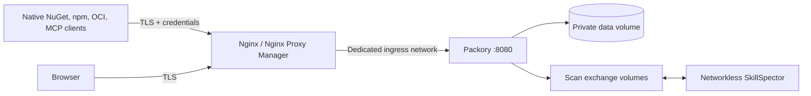

# TLS reverse-proxy reference profile (issue #131)

This is a **reference integration**, not an installed service, live-network change
or production release. It depends on the six `_FILE` variables in [mounted
runtime secrets](operations.md#mounted-runtime-secrets-opt-in-docker-profile)
and still requires separate production acceptance in [release gates](release-gates.md).

## Architecture and risk boundary

No Packory container port is published to the host. Only the application
attaches to the operator-owned `PACKORY_INGRESS_NETWORK`; the scanner
retains `network_mode: none`, read-only root, non-root UID and dropped
capabilities. The proxy must itself be attached to this **dedicated** network.
Treat every other connected container as a potential peer: Docker networks
are not an authorization boundary against hostile privileged containers.

## Deploy only after explicit acceptance

1. Provision an operator-owned Docker ingress network (for example,
   `docker network create --driver bridge packory-ingress`) and attach
   the trusted ingress container. Avoid a shared catch-all network.
2. Prepare three host-managed secret files **outside Git** with unique,
   random credentials (minimum 32 characters for API tokens). Set
   `PACKORY_ADMIN_TOKEN_SOURCE`, `PACKORY_READ_TOKEN_SOURCE` and
   `PACKORY_WRITE_TOKEN_SOURCE` to their absolute paths. For non-root
   runtime readability and Compose file-bind permission limitations, see
   [secrets](operations.md#mounted-runtime-secrets-opt-in-docker-profile).
3. Pin `PACKORY_APP_IMAGE` and `PACKORY_SKILLSPECTOR_IMAGE` to **matching
   tested source revisions** using full `ghcr.io/cenn0/…@sha256:…`
   references. Record the source SHA, both digest values and evidence.
   Matching a tag name alone is not proof of an identical build.
4. Set `PACKORY_PUBLIC_BASE_URL` to the exact **HTTPS origin** (for example,
   `https://packory.example.invalid`, with no path/credentials/query),
   and `PACKORY_INGRESS_NETWORK` to the existing private network.
5. Validate using `docker compose -f compose.proxy.yaml config --quiet`.
   Verify the effective Compose config publishes **no Packory host ports**
   and exposes **no secret values**; then start the stack under your own
   operator process. `restart: unless-stopped` does not certify host
   reboot persistence or recovery.
6. Place [the nginx reference](../deploy/nginx/packory.conf.example) in
   a controlled Nginx `http` context and replace the synthetic FQDN and
   certificate paths. TLS must be terminated and validated at this proxy;
   do not use `http://` for remote native clients. Keep a default TLS
   virtual host that **rejects unmatched Host/SNI names**.

Nginx limits in the example are explicit starting bounds, **not** universal
production SLOs: body 256 MiB (the application may reject smaller/larger
per-route requests), client-body timeout 60 s, upstream connect 15 s,
read/send 300 s, edge rate 30 requests/s per peer, and 40 concurrent
connections per peer. Tune limits against actual pinned workload and
document retry/streaming behavior. `proxy_request_buffering off` permits
large streamed requests to reach the application incrementally; disable
unbounded proxy temporary files and ensure upstream size limits remain in
force. Do not trust inbound client-provided `X-Forwarded-*` identity/IP
headers. Packory intentionally uses `PACKORY_PUBLIC_BASE_URL` to construct
external protocol links rather than blindly trusting those headers.

## Auth boundaries (Nginx and Nginx Proxy Manager)

**Native routes must never be redirected to HTML login**: `/nuget/`,
`/npm/`, `/v2/`, `/feeds/`, `/mcp`, `/.well-known/` and protocol
authentication/token endpoints require native credentials and Packory's
actual authorization. Keep both `Authorization` and protocol-specific
`X-NuGet-ApiKey` intact. OCI WWW-Authenticate challenges, npm tarball
URLs, NuGet V3 service-index URLs, MCP 401 responses and OAuth protected
resource discovery must pass through unmodified. No `proxy_set_header`
must convert caller-supplied username, email, cookie, `Remote-User`,
`X-Forwarded-User` or external forward-auth assertions into a Packory
principal. Do not introduce `UseForwardedHeaders` with a permissive proxy
list as a shortcut.

In Nginx Proxy Manager, configure the host's **scheme=http,
forward-host=packory, forward-port=8080**, enable a valid TLS certificate,
force SSL and use the same private network. Do not apply the GUI's blanket
access-list/login gate to native paths. If an external forward-auth layer
is required for HTML UI access, design and test an **explicitly separate
UI-only** route or hostname; direct Packory API permissions must still be
validated by Packory. An external identity login is **not** Packory browser
SSO or delegated authorization (separate issue #130). Unauthenticated
browser API access must stay denied where Packory requires credentials.

Never put credentials in browser addresses, Compose environment values,
image layers, access logs or public debugging records. The example disables
Nginx access logs until the operator provides safe, bounded redacted logging
that excludes authorization headers and query strings.

## CI-only Compose isolation checks

`scripts/validate_deployment_compose.sh` expands both file-secret and
private-ingress profiles with **synthetic placeholder paths and image
references**. It validates that the worker remains networkless/non-root,
no direct secrets enter the app environment, loopback binds to 127.0.0.1,
and private ingress uses only an external network without host ports.
Expanded configurations (which may include host paths) are never printed
to CI logs. This is a **static Compose configuration check**, not evidence
that non-root mounts, TLS, native clients, image digests or host recovery work.

## CI-only static expansion guard

The `scripts/validate_deployment_compose.sh` job now rejects noncanonical
`PACKORY_PUBLIC_BASE_URL` values (userinfo, paths, query strings, fragments,
loopback origins, invalid HTTPS ports), mutable or foreign private-ingress
container images, root application overrides and secrets passed to the
networkless scanner. Private-ingress images must use the exact
`ghcr.io/cenn0/packory@sha256:<64 lowercase hex>` and
`ghcr.io/cenn0/packory-skillspector@sha256:<64 lowercase hex>` forms.
The origin is an ASCII DNS hostname or bracketed IPv6 address, optionally
followed by a valid TLS port; use a punycode hostname for internationalized
domains. Run the expansion script in an isolated CI environment with only
synthetic sources; it intentionally does not display resolved Compose values.

**Limit:** this only verifies configuration shape, not image authenticity,
whether both images represent the same revision, non-root secret readability,
actual TLS, OAuth/native-client behavior, daemon persistence or security
of other containers attached to the network. Retain separate real-service
acceptance and digest/source provenance checks.

## Required independent HTTPS acceptance (not executed by the example)

Bind every result to exact application/worker digests, source SHA,
certificate origin and pinned client versions. Use only synthetic packages,
throwaway credentials and an isolated ingress network. Record **passed,
failed and skipped separately**, without raw client logs containing tokens:

| Probe | Required outcome |
| --- | --- |
| `GET /health/live`, `/health/ready` over TLS | Intended liveness/readiness; an HTTP 200 alone proves no protocol operation |
| NuGet V3 `dotnet nuget push`, restore + SHA-512 | Authenticated publish/consume with canonical HTTPS service links |
| `npm publish`/fresh install/ci + tarball digest | Native identity/auth, HTTPS tarball URLs and immutable content |
| Docker/OCI login + push/pull by immutable digest | HTTPS native challenge, auth and exact digest round trip |
| MCP official SDK initialize/tools over TLS | Authorized Streamable HTTP plus correct 401 and WWW-Authenticate/OAuth metadata |
| Anonymous/read-only publish, invalid tokens, spoofed proxy headers | No unauthorized read or write and **no** HTML login success paths |
| Recreate app/worker; restart Docker daemon | Persistent volumes/secrets/network attachment; retest canonical links |
| Proxy stream aborts, quota/large body and deliberate outage | Bounded failures, no leaked internal hostnames, incomplete artifacts not served |

The existing [native harnesses](ci-qualification.md) cover substantial
**loopback HTTP** behavior and storage recovery. They do **not** prove the TLS
proxy paths above. Until the independent host/client matrix passes, mark
the proxy feature **available as a reference configuration only**, not
officially qualified, production-recommended or security certified.
