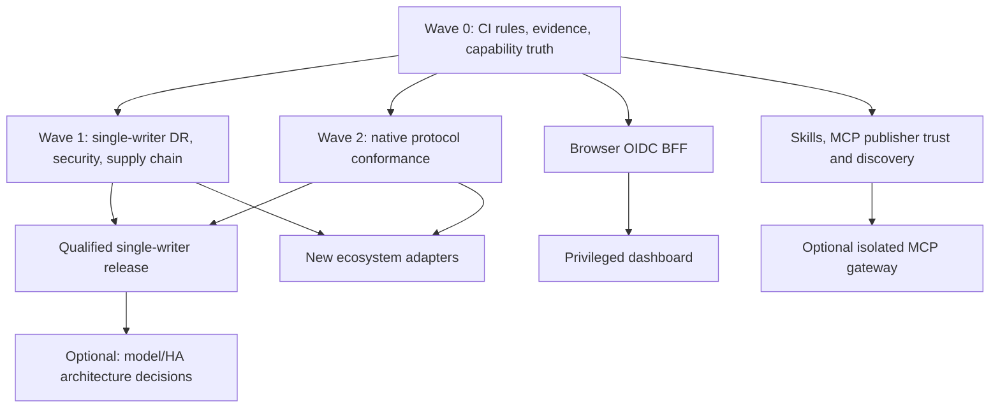

# Packory Roadmap V5 — consolidated, evidence-gated delivery

**Baseline:** 22 October 2026, main commit [6aa9835](https://github.com/Cenn0/Packory/commit/6aa983577bea14eace79bae270cdf48a070372e4).
**Status:** active development; native hosted-feed baseline tested, **not** generally production-qualified.
**Purpose:** a single ordered execution plan for remaining work. Older [V3](roadmap.md), [V4](roadmap-v4.md), [experimental graduation](experimental-graduation.md), [MCP](mcp-roadmap.md) and [Skill security](skill-security-roadmap.md) plans remain detailed historical/workstream references; V5 governs sequencing and release claims.

This is an inventory of merged code and documented test evidence, **not a newly executed full regression or an independent production audit**. Always recheck status and CI against the exact commit being promoted. Product goal: a self-hosted distribution hub for native package ecosystems, immutable generic artifacts, approved Agent Skills and reviewed MCP metadata. Preserve the modular .NET 10 monolith until measurable needs justify a different topology. Do not confuse a generic blob endpoint with native client compatibility.

## 1. Verified repository inventory and reconciliation

| Topic | Observed at baseline | Remaining distinction |
| --- | --- | --- |
| GitHub coordination | Three open issues: [#36 release/DR](https://github.com/Cenn0/Packory/issues/36), [#76 protected-main CI](https://github.com/Cenn0/Packory/issues/76), [#91 native ecosystem expansion](https://github.com/Cenn0/Packory/issues/91); **zero open PRs** at inspection | Issues describe acceptance, not proof of completion |
| E0 hosted feed foundation | [#110](https://github.com/Cenn0/Packory/pull/110) merged: private isolated NuGet, npm, Cargo, PyPI, OCI, Maven, Go and Raw adapters; [E0 acceptance](e0-acceptance.md) records local CLI, PostgreSQL/Moto, restoration and regression evidence | No automatic private proxy/group guarantees, browser sessions, real-provider certification or blanket protocol support |
| NuGet | [#114](https://github.com/Cenn0/Packory/pull/114) added private search and paginated registration | Native client version matrix, symbols, unlisting, SemVer edges, advisories and trust policy |
| npm | [#115](https://github.com/Cenn0/Packory/pull/115) added durable private dist-tag mutation, schema V13 | Unpublish/deprecation policy, provenance, scoped proxy and pnpm/Yarn compatibility |
| Cargo / PyPI / OCI | Tested hosted profiles and selected pinned native clients per [support matrix](support-matrix.md) | Private Cargo yank and mirror; PyPI metadata/version breadth; OCI bearer-token issuer and Docker/ORAS matrix |
| Maven / Gradle | [#111](https://github.com/Cenn0/Packory/pull/111) added native release/SNAPSHOT deploy and Gradle consumption; [#113](https://github.com/Cenn0/Packory/pull/113) added inherited POM identity and plugin-prefix metadata | All-file atomic publication, upstream proxy, broader variants, native/provisioned recovery evidence for #113 |
| Go / Raw | Private Go GOPROXY and immutable triplet importer; hosted Raw authenticated generic bytes | Go checksum-database trust and mirror, archive/version parity; Raw quota and retention |
| Skills / MCP | Approval/revocation and offline SkillSpector; static Skill quality; read-only MCP and limited Registry v0.1 metadata; bounded TypeScript SDK evidence | Publisher proof, signatures, durable assessment history, agent/connector behavior, per-feed discovery and full Registry lifecycle |
| Containers | [#116](https://github.com/Cenn0/Packory/pull/116) merged a workflow that builds two GHCR development images after successful main push CI | Workflow configuration is **not** proof of a published image. Verify the exact triggering CI run, publish run, anonymous pull, image digest and deployment smoke. No automatic rollout |
| Production | SQLite/filesystem and PostgreSQL/S3-emulator scenarios; single-writer advisory lease and restricted replicas | No attached real S3 provider/PG restore qualification, complete browser security audit, full supply-chain release or measured operations/SLO evidence. No active-active support |

**Doc-drift discovered:** the earlier experimental ledger still calls #115 pending; README text says private npm lacks a mutable tag API; the Maven capability description still lists plugin-prefix metadata as absent despite #113. Reconcile these and the [support matrix](support-matrix.md) with actual merged code before claiming graduation. Treat old status snapshots as dated evidence, not live status.

## 2. Release tiers and product boundaries

| Tier | Requirement | Allowed claim |
| --- | --- | --- |
| T0 — Implemented | Merged code and explicit scope | "Implemented"; no interoperability guarantee |
| T1 — Tested | Pinned commit, native client+operation+OS+backend test, positive and negative evidence | "Tested for the listed combination" |
| T2 — Packory-supported | Maintained compatibility matrix, repeatable client/provider tests, configuration, security boundaries, recovery and upgrade contract for the advertised profile | "Supported by Packory for this *specific profile*"; **not** officially endorsed by an upstream package-manager vendor |
| T3 — Production recommendation | Actual deployment/provider security, restores, operations, signatures and measured service objectives satisfy [release gates](release-gates.md) | "Recommended for the qualified deployment" only, never blanket certification |

**Two distinct delivery targets:** (A) a limited, self-hosted **single-writer headless registry release** with explicit supported protocols; (B) a browser-managed, multi-ecosystem distribution platform. Browser BFF work is a gate for privileged browser operations, not automatically a prerequisite for a headless-only profile. Future active-active writes are a **separate architecture initiative**, not a hidden prerequisite for the single-writer target.

## 3. Prioritized implementation backlog

Priority semantics: **P0** security, integrity, release blockers; **P1** complete already-delivered product paths; **P2** deliberate extension to new ecosystems; **P3** optional/conditional scope. Each item closes only when its listed acceptance passes on the proposed commit.

### Wave 0 — trustworthy baseline, automated distribution and governance (P0)

| ID | Work | Objective acceptance |
| --- | --- | --- |
| V5-00 | Reconcile README, capability API, support matrix, E2/MCP notes and EXP ledger after #113–#116 | One consistent per-protocol status from code, docs, API and observed test evidence; stale statements removed; no unsupported "production" claim |
| V5-01 | Enforce effective main branch CI protection — [#76](https://github.com/Cenn0/Packory/issues/76) | Authorized admin verifies legacy protection, rulesets, bypass and required contexts; deliberately failing synthetic check **blocks** merge; passing PR succeeds; deletion and force-push stay prohibited |
| V5-02 | Verify automatic main GHCR delivery | Confirm upstream CI success, subsequent image workflow success, both images from one commit, non-root smoke, digest labels and anonymous pull when intended; show documented upgrade/rollback. Failures must not advance mutable main tags; development tags must not imply release |
| V5-03 | Create one reproducible release evidence index | For each advertised profile: pinned revision, runner/OS, client and provider versions, successful and denied operations, workflow URL, known gaps and reviewer approval; skipped provider tests explicitly **not** pass |

**Exit:** no status contradictions, documented CI branch enforcement and verifiable developer images. These improvements do not by themselves close the production gate.

### Wave 1 — single-writer resilience and release assurance (P0; [#36](https://github.com/Cenn0/Packory/issues/36))

| ID | Work | Objective acceptance |
| --- | --- | --- |
| V5-10 | Real S3 object-provider conformance | On the intended provider: independent concurrent conditional create/delete, race/retry/partition, versioning, retention and orphan/quarantine policy; hash-checked objects and failure recordings; test in disposable isolated resources |
| V5-11 | Coordinated PostgreSQL + S3 restore | Quiesce writes; freeze coherent DB watermark/object versions including pending intents, metadata, OCI/Skills and all private feeds; restore into **isolated** infrastructure; verify digests and native-client access; measure achieved RPO/RTO, never invent targets |
| V5-12 | Migration/rollback and crash recovery | From documented prior release/schema through current; fail before/after DB and blob commit boundaries; prove immutability, no phantom metadata, safe orphan recovery, rollback limits and restore of active feed grants |
| V5-13 | Threat model, scoped authorization and audit | Cross-feed and global namespace tests for all public routes incl. search/MCP, revoked grants, SSRF/redirect/rebinding, upload exhaustion and denied-action audit/redaction; define publisher/provenance policy |
| V5-14 | Release supply chain and provenance | Verified reproducible/pinned dependency and base-image policy, SBOM, license and vulnerability scan, signed provenance and release artifacts; security severity waiver policy and independent verifier; no secret in Actions artifacts |
| V5-15 | Operability and emergency response | Observable errors/saturation/audit, backup alerts, concurrency/load/fuzz tests, deployment TLS/secret rotation, upgrade/rollback/canary and incident drills; measured SLO/error budget and capacity for reference deployment |
| V5-16 | Gated single-writer release | Independent completion review of [release gates](release-gates.md) with accurate scope; publish a tagged release **only** for the qualified combinations, not an automatically promoted development main tag |

**Do not equate PostgreSQL session lease checks with independent writer fencing.** A single-writer deployment must reject unsafe failover; distributed multi-writer/partitioned operation needs a separate fencing/consensus design and fault proof before enabling it.

### Wave 2 — graduate existing protocol profiles (P1, independently releasable)

| ID | Protocol | Implementation and acceptance |
| --- | --- | --- |
| V5-20 / EXP-01 | NuGet | Finish private search/registration/SemVer edge and transitive client matrix; separate symbols/unlisting and signed-package policy; cold/warm restore, byte parity, revocation, malformed manifests and provider restore |
| V5-21 / EXP-02 | npm | Validate merged tag mutation under concurrent writes, restart/recovery, scoped auth and native install; add explicit deprecate/unpublish policy and optional scoped proxy; pinned npm/pnpm/Yarn lockfile matrix; provenance not claimed without verification |
| V5-22 / EXP-03 | Cargo | Private yank/unyank and native index semantics; explicit allowlisted crates.io read-through as separate work; named Cargo versions, two independent feeds, cache/index consistency and missing/denied tests |
| V5-23 / EXP-04 | PyPI | Broaden exact PEP 440/Requires-Python behavior, accepted wheel/sdist variants, optional metadata sidecars/yank and trusted proxy; verify native pip/Twine with strict no extra-index confusion |
| V5-24 / EXP-05 | OCI/Helm | Standard scoped bearer challenge/token service if advertised; Docker/ORAS/Helm client matrix, referrer/digest, chunk-resume/restart and bounded descriptor tests; explicit delete/GC policy and no multi-node handoff claim |
| V5-25 / E2 | Maven/Gradle | Define publication transaction boundary for POM/JAR/classifiers/metadata, implement atomic visibility or explicit fail-closed staging; separate allowlisted Central proxy; pin Gradle module/plugin variants; repeat #113 native/provider/migration qualification |
| V5-26 / E3 | Go | Allowlisted upstream GOPROXY mirror with independently specified checksum-database trust and bypass rules; pseudo-version/archive compatibility, path/case handling, isolated native Go caches, interrupted publication and provider restore |
| V5-27 / EXP-07 | Raw | Explicit quota, retention, content policy, safe ranged reads and permission-consistent REST/UI/MCP discovery; describe as HTTP bytes, **not** native package-manager support |

A P1 profile can graduate to T2 without every optional extension being implemented, provided the intentionally limited operations are accurately advertised, documented and fully qualified. Never silently expand an adapter's support claim.

### Wave 3 — identity, governance, Skills and MCP (P1; independent workstreams)

| ID | Scope | Objective acceptance |
| --- | --- | --- |
| V5-30 / EXP-11 | Optional Keycloak/OIDC **browser BFF** | Auth-code + PKCE, server-only session, secure cookies/CSRF, logout/refresh/revocation, role changes and feed-level authorization; no long-lived provider tokens in browser storage; end-to-end denied action tests |
| V5-31 / EXP-14 | Privileged dashboard | After V5-30: feed lifecycle and grants, credential rotation, ingestion policy, audit, restore/health and review queues; role-based accessibility, keyboard use, errors/empty states, stale-auth isolation and browser E2E |
| V5-32 / EXP-08 | Agent Skills publisher and signature trust | Namespace ownership proof, immutable ZIP digest signatures, revocation/rotation, staged scan evidence and fail-closed approval; independently qualify scanner detection limits and false positives; no execution in registry process |
| V5-33 / MCP-R2b–R6 | MCP Registry specification | Official schema fixtures for admitted manifests; publisher identity and provenance; allowlisted read-only upstream sync with checkpoints/retries; publish/status/version lifecycle, tombstone/audit and durable restore |
| V5-34 / MCP-P4–P7 | MCP discovery/auth and clients | Per-feed filtered catalog and install guidance; independent SDK/client+HTTP/version matrix; bounded pagination/load/denial; advertise only actually implemented protocol features |
| V5-35a / AI-01–AI-12 | Optional SkillSpector AI-assisted review | Experimental implementation: isolated networkless AI sidecar with API-relayed approved providers, admin UI/settings/jobs, recorded policy revision and costs, independent human approval; verify real-provider smoke, provider compatibility, BFF and production secrets/DR separately | 
| V5-35 / MCP-Q2–Q8 | Skill/agent/connector quality | Versioned durable assessment history; declared manifest/schema validation; isolated disposable, unprivileged behavior runner with **denied egress by default**; reproducible fixtures, evaluation caveats and reviewable improvement suggestions |
| V5-36 / MCP-G1–G5 | Optional external MCP gateway | **Separate trust boundary and optional opt-in**: reviewed outbound allowlist, identity/audience separation, consent, egress/dns/redirect controls, tool permissions, resource limits and independent client/server qualification |

Static checks or human approval do not establish publisher ownership, code safety or demonstrated agent behavior. Never execute untrusted artifacts in the Packory API.

### Wave 4 — new native ecosystems (P2; after shared gates are mature)

| ID | Order | Acceptance |
| --- | --- | --- |
| V5-40 / E4 | RubyGems + Bundler Compact Index | Protocol ADR, immutable hosted release, allowlisted mirror, native gem push/install and bundle install including transitive dependencies, authentication and corrupt-index tests |
| V5-41 / E5 | Composer 2 | Exact packages metadata/dist integrity, hosted/private and later safe allowlisted proxy, native composer install/update, credential/redirect and lockfile checks |
| V5-42 / E6.1 | Terraform/OpenTofu **modules** | Module version/download protocol, native terraform init against private module; provenance, redirects and authorization |
| V5-43 / E6.2 | Terraform/OpenTofu **providers** | Separate provider version/platform checksum/signature protocol, at least two OS/architecture client profiles and trust-key lifecycle |
| V5-44 / E7 | Conan 2 | Recipe/revision/binary package ID consistency, two profiles and native create/upload/install, concurrent revision/fault recovery |
| V5-45 / E8.1 | APT | Coherent signed suite/component/architecture snapshots; isolated apt update/install and expired/malformed/wrong-key negative cases |
| V5-46 / E8.2 | RPM/DNF | Coherent signed repodata, architecture/version semantics and key rotation; isolated dnf makecache/install with corruption and trust failures |

Implement **hosted → native-client acceptance → private IAM → storage/recovery → optional proxy → UI/MCP** in small PRs *per ecosystem*. Do not mark entire Wave 4 complete when only one format passes. Native APT/RPM signing and provider trust are not interchangeable with generic ZIP storage.

### Wave 5 — conditional product expansion (P3; explicit ADR first)

- V5-50: Research Conda, Swift Package Registry, classic Helm repositories and Windows ecosystems separately; decide demand, spec/version, maintenance and security economics before writing an adapter.
- V5-51: AI model/large artifact distribution only after a concrete model manifest, licensing/provenance, multipart capacity, resumability and native client/consumer contract is selected. Current model catalog is **not implemented**.
- V5-52: Active-active/multi-writer only if measured single-writer limits justify complexity; design independent fencing/consensus, partition safety and failure/rejoin; **never** advertise it on the existing lease.
- V5-53: Evaluate splitting runtimes or adding external brokers only with benchmarks, fault-domain analysis and an ADR. The modular monolith remains the default.

## 4. Dependency and graduation graph

The dependencies deliberately avoid blocking a **headless** release on every browser/MCP enhancement or on future native ecosystems. Conversely, no new adapter is publicly supported until its own provider/security/client evidence is complete.

## 5. Shared definition of done (every PR / milestone)

1. Link an issue/roadmap ID, affected native specification and declared **non-goals**; identify exact route/feed/storage/auth boundaries.
2. Include positive, negative and regression tests for native client/transport, identifiers, integrity, namespace collision, 401/403/404, immutable publication, retries and restoration as appropriate.
3. Pin the code commit, client/SDK versions, OS/runtime, provider, operation and actual outcome. Report skipped tests separately, with no inferred pass.
4. For schema/storage changes, prove migrations, interruption before and after durable boundaries, rollback/restore and checksum consistency on SQLite/filesystem and configured PostgreSQL/S3 emulator. Actual-provider qualification is separate.
5. Validate public-source privacy: no real identity, email, secrets, real deployment URLs, internal logs or private-project references in commits, evidence, diagrams, fixtures, PRs or workflow artifacts.
6. Update capability claims, support matrix, API/operations documentation, client setup, security limitations and release notes **in the same PR**.
7. Require branch-policy review and green applicable checks on the exact PR head before merge. A PR/CI success does not authorize T2 or T3 automatically.

## 6. Governance and next executable tranche

**First tranche, in strict order:** V5-00 → V5-01 (administrator action) and V5-02 → V5-03 → V5-10/V5-11 → V5-12/V5-13. Run V5-20/V5-21/V5-25 as separate protocol PRs in parallel only when changes cannot weaken these foundations.

**Tracking:** keep [#36](https://github.com/Cenn0/Packory/issues/36) as the production release gate, [#76](https://github.com/Cenn0/Packory/issues/76) for required status checks, and [#91](https://github.com/Cenn0/Packory/issues/91) for native ecosystem expansion. Add focused issues for selected IDs when scheduled; avoid bulk-creating placeholder issues or asserting arbitrary percent completion. Close a parent only after each promised acceptance is independently linked and reviewed.

## 7. Integration checkpoint — 22 October 2026

The proposed integration combines #118 and #119, repairs their cross-branch
Cargo consistency regression, reconciles V14 architecture/README statements,
adds [complete CI qualification and a public result index](ci-qualification.md),
and extends coordinated PostgreSQL/Moto recovery to npm tag tombstones and
Cargo yank state. These are scoped implementation increments for V5-00,
V5-01/V5-02/V5-03, V5-12 and V5-22. They do **not** close all acceptance
criteria, constitute independent approval, or complete the 37-point roadmap.

| IDs | Current boundary / next required acceptance |
| --- | --- |
| V5-00 | Integration reconciles npm/Cargo/V14 claims; final CI and independent review required |
| V5-01 | Aggregate check implemented; administrator-required contexts, bypass review and red/green enforcement proof remain |
| V5-02 | Full-workflow publish gate prepared; observe exact post-merge GHCR build/pull/digest and deployment smoke |
| V5-03 | Minimal exact-commit CI index implemented; full version/provider/operation records and independent approval remain |
| V5-10 | Requires selected real provider and authorized isolated resources; emulator success cannot close it |
| V5-11 | Requires coordinated real-provider restore and measured RPO/RTO |
| V5-12 | V14/V15 PG/Moto recovery fixtures, SQLite offline annotations and both-provider V14→V15 migration tests added; full crash/operator rollback acceptance remains |
| V5-13 | Change-scoped authorization/integrity review only; comprehensive route/SSRF/audit review remains |
| V5-14 | SHA-pinned Actions and source integrity exist; complete SBOM/signatures/license/vulnerability/provenance review remains |
| V5-15 | Bounded .NET request/duration/denial instruments and admin process totals implemented; deployment load, alerts, rotations, incident and SLO measurements remain |
| V5-16 | Blocked on applicable independent release acceptance; no tagged release authorized by a green CI index |
| V5-20 | Existing NuGet profile; remaining symbols/unlisting/trust/client matrix unchanged |
| V5-21 | Durable scoped tags and V15 per-version deprecation management implemented; native deprecate/clear with atomic CAS overlays and pinned npm/pnpm/Yarn Classic lockfile CI added; modern Yarn, provenance and profile graduation remain |
| V5-22 | Private V14 Cargo yank/unyank integrated; allowlisted mirror, broader clients and graduation evidence remain |
| V5-23 | Private wheel PEP 658/714 sidecars implemented with exact-byte and authorization tests; broader versions/distributions/yank/proxy remain |
| V5-24 | Existing hosted OCI profile; bearer issuer, broader clients and complete delete/GC qualification remain |
| V5-25 | Maven inherited coordinates/plugin metadata retained; publication boundary/proxy/broader variants remain |
| V5-26 | Hosted Go profile; safe mirror, checksum trust and archive/version breadth remain |
| V5-27 | Bounded feed/query-scoped REST keyset discovery added on both providers; logical single-writer quotas and explicit indefinite retention implemented; MCP/UI discovery and physical-provider qualification remain |
| V5-30 | Browser BFF and its security/E2E acceptance remain unimplemented |
| V5-31 | Privileged dashboard depends on V5-30; current catalog UI does not satisfy it |
| V5-32 | Existing static scan/approval does not verify publisher signatures or ownership |
| V5-33 | Inert reviewed MCP Registry profile exists; full publisher/sync/lifecycle qualification remains |
| V5-34 | Existing read-only global MCP; private discovery and broader independent clients remain |
| V5-35 | Existing static Skill quality; durable behavioral assessment and isolated runner remain |
| V5-36 | Optional gateway remains unimplemented and requires its separate trust boundary |
| V5-40 | RubyGems/Bundler adapter and native acceptance remain unimplemented |
| V5-41 | Composer adapter and native acceptance remain unimplemented |
| V5-42 | Terraform/OpenTofu module registry and native acceptance remain unimplemented |
| V5-43 | Provider protocol/signing/trust matrix remains unimplemented |
| V5-44 | Conan revision/binary/native profile remains unimplemented |
| V5-45 | Signed coherent APT snapshots/native trust checks remain unimplemented |
| V5-46 | Signed RPM metadata/native trust checks remain unimplemented |
| V5-50 | Conditional ecosystem research/selection requires demand and an ADR |
| V5-51 | Conditional model manifests/licensing/client contract and capacity evidence required |
| V5-52 | Conditional multi-writer work requires measured need, independent fencing and partition proof |
| V5-53 | Conditional runtime split/broker work requires benchmarks and an ADR; monolith retained |

All 37 IDs remain subject to their original objective acceptance. Do not
reinterpret these scoped increments as completion of external or conditional
gates. The effective ruleset observed at this checkpoint requires one
independent approval; #118 and #119 had no submitted reviews. Their existing
individual green runs cannot substitute for integrated-branch qualification.

**No artificial schedule:** no dates, percent complete or estimates are asserted without assigned capacity and measured throughput. Prioritize completion of the limited supported single-writer core over expanding the unchecked protocol inventory.

## Subsequent implementation tranche

Five functional packages extend V5-03 (redacted client/OS inventories),
V5-15 (bounded .NET observations and admin totals), V5-23 (wheel metadata
sidecars), V5-27 (private Raw keyset discovery) and V5-21 (durable private
npm deprecation management). V5-12 adds V15 migration and both recovery
profiles. These are bounded delivered features, not six fully graduated
roadmap workstreams. Real-provider qualification, complete native protocol
matrices, privileged browser identity/UI, signatures and the new ecosystem
adapters remain open. The final independent security check is external to
this implementation tranche and must not be represented as completed CI.

## Native npm lifecycle checkpoint — 23 October 2026

V5-21 now includes native npm deprecate/clear, digest-bound packument revisions,
atomic multi-version overlays/audit and optimistic concurrency on both metadata
providers. No schema change is needed beyond V15. `FeedNpmTests` covers native
shape, same-feed grants, rejected manifest edits, stale revisions, transactional
rollback, reopening and immutable bundle parity. The private npm CLI harness
now uses native deprecate/clear rather than the Packory-specific mutation API.
This completes this lifecycle slice, not the broader pnpm/Yarn/provenance or
provider production acceptance. V5-01 remains externally blocked by effective
branch-policy access; V5-10/11 require selected real-provider resources.

## Container delivery checkpoint — 23 October 2026

V5-02/03 now add a credential-free full-image delivery verifier and a sanitized
exact-source digest evidence artifact. The publisher must successfully hash
both SHA-tagged manifests, configs and every compressed layer before promoting
either mutable main tag. Invalid labels, root identity, missing/altered content
and an unsupported platform/manifest fail closed. Deterministic transport and
workflow tests cover failures independently of real registry observations.
This verifies the declared single-platform delivery profile; it does not
replace image runtime, source CI, reviewer or deployment/release acceptance.

## Raw quota checkpoint — 23 October 2026

V5-27 includes optional independent byte/count limits on committed private Raw
assets, an exact-feed usage endpoint, concurrent-limit regression cases and
HTTP-client quota acceptance. Both metadata providers calculate usage from the
restored ledger; failed quota admissions do not write intents or blobs.
Retention is explicitly indefinite, with no online delete or automatic GC.
This does not complete UI/MCP parity, physical bucket accounting or production
provider qualification. The single-writer boundary is unchanged.

## Native consumer matrix checkpoint — 23 October 2026

V5-21 adds a mandatory exact-source native-matrix job for npm 11.9.0, pnpm
10.20.0 and Yarn Classic 1.22.22. It checks isolated transitive bytes, origin
and integrity lock records, fresh-store locked reinstalls after restart and
explicit lock-mismatch failure against an existing alternate release. The
qualification gate requires this job by name; omission cannot silently pass.
Modern Yarn, a wider client/provider matrix, provenance and full production
acceptance remain open.

The consumer-matrix review also rejects malformed `deprecated` fields during
publication and immutable-metadata reads, with a regression for null/non-string,
control-containing and oversized values. No schema change or payload rewriting
is introduced. Separate security review remains deferred to the user.

The final provider CI exposed a pre-existing concurrent PostgreSQL first-start
DDL race (`pg_type_typname_nsp_index`). Metadata, Skill-release and MCP-catalog
initialization now share a database/schema advisory lock, with a twelve-start
fresh-schema regression and failure/retry coverage. This is an incremental
V5-12 startup correction, not distributed writer fencing or full DR acceptance.

## 23 October 2026 review corrections

The [architecture, correctness and security review](review-2026-10-23.md)
corrects REV-01–REV-13: bounded/deadlined upstream reads, uniform npm
integrity admission, Skill YAML/archive/dispatch consistency, safe static
report ingestion, null-safe decisions, S3 abandoned-stage retries, complete
AI backup fingerprints, writer-lease admission and hosted OCI descriptors.
These are verified corrections within V5-12/V5-13/V5-20/V5-21/V5-24/V5-32/V5-35a,
not closure of those broader workstreams or of any external release gate.
The review records exact local evidence and unexecuted provider/container checks.
